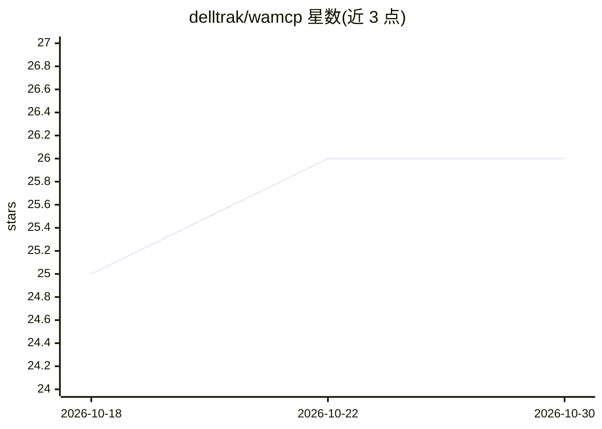

# delltrak/wamcp

⭐ 26 · TypeScript · 推送 2026-10-28 · [GitHub](https://github.com/delltrak/wamcp) · 个人维护

**让 AI agent 通过 MCP 接入 WhatsApp 的服务器**

用 TypeScript 编写的 WhatsApp MCP 服务器：把 WhatsApp 的收发消息、群组管理、联系人、定时发送、语音转写（音频转录）、TTS 语音笔记等能力封装为 163 个 MCP 工具、10 个资源与 22 个实时事件，供 Claude、Google ADK、LangChain 等 MCP 兼容 agent 框架自动发现调用。后端支持 Baileys（WhatsApp Web）与 Meta Cloud API 双通道，单服务器可运行 1–50 个号码，BullMQ 限流队列（20/80 条每分钟），SQLite 或 PostgreSQL 持久化。docker compose 一条命令部署，外部依赖仅 Redis；本地运行需 Node.js >= 24。定时发送功能默认关闭，需环境变量开启；音频转录、TTS、Chatwoot 桥接均为可选功能。

## 筛选速览

| 维度 | 判定 | 备注 |
|---|---|---|
| AI 角色 | `ai-ecosystem` | LLM/agent 周边工具 |
| 许可风险 | `none` | — |
| 部署形态 | `self-host` | docker 或自建部署 |
| 模型依赖 | locked-api |  |
| 硬件要求 | — | 无带数字的原话,不猜 |
| 安装摩擦 | `low` | 无编译、无系统依赖或容器化 |
| 成熟度 | — | 结构信号不足 |

## 能力要点

- 163 个 MCP 工具覆盖消息、群组、定时发送、转录、TTS 等 17 个域
- Baileys 与 Meta Cloud API 双通道，同一接口
- BullMQ 限流（Baileys 20 条/分钟、Cloud 80 条/分钟）与自动重连
- 单容器部署，外部依赖仅 Redis；1–50 实例多号码运行

## 适用场景

- 让 Claude/Google ADK/LangChain agent 直接读写 WhatsApp 消息
- 构建 WhatsApp 自动化机器人或客服流程
- 用 agent 管理多号码 WhatsApp 的群组、联系人与定时任务

## 场景标签

 · 领域:AI agent 工具/消息通讯

## 证据(README 行号)

> L27: **WA MCP** is a WhatsApp MCP server built with TypeScript that gives AI agents full access to WhatsApp through the 
> L35: Instead of writing HTTP clients, parsing webhook payloads, and mapping endpoints to tools manually — your agent jus

## 星数曲线

2026-10-18 25 → 2026-10-30 26（+1）

---
*卡片 v1 · prompt 1.4 · 生成 2026-10-26 · 置信度 high · 依据 README sha `a9c40f1b7b59` · [字段定义](../../DATASET.md)*
