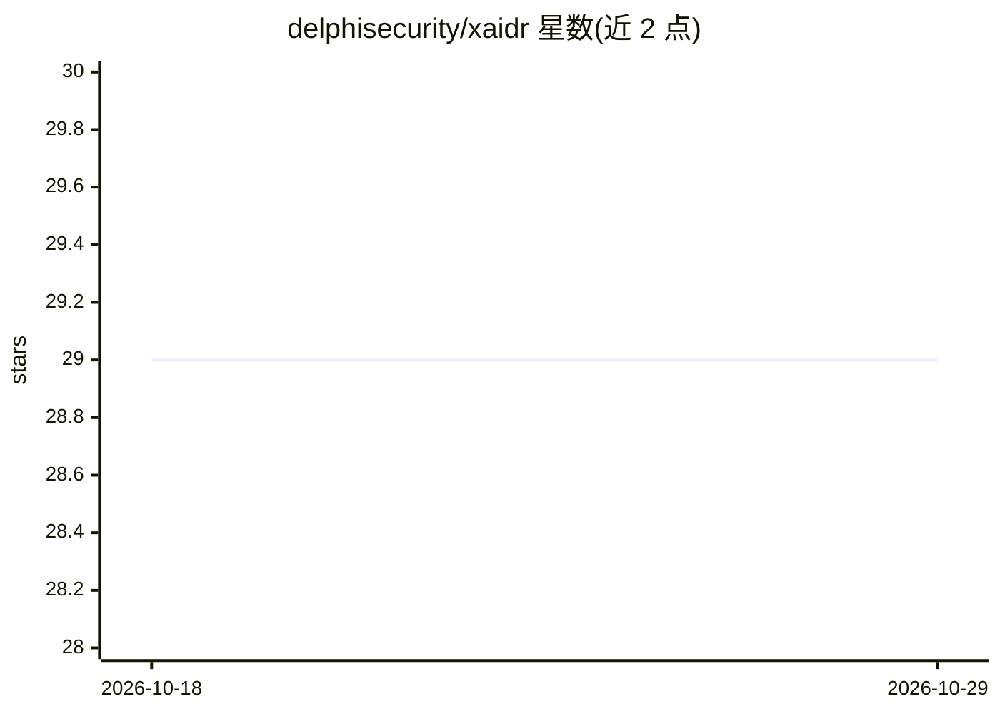

# delphisecurity/xaidr

⭐ 29 · Python · Apache-2.0 · 推送 2026-10-26 · [GitHub](https://github.com/delphisecurity/xaidr) · [官网](delphisecurity.ai/xaidr) · 组织维护

**AI agent 运行时安全传感器：进程内检测提示注入与危险工具调用**

面向 AI agent 开发者的进程内执行层安全库，以 Python 包安装，零必需依赖。在输入、模型输出、工具调用、A2A 协议消息四个边界扫描提示注入、越狱模式、破坏性命令、密钥泄露与协议滥用，输出 allow/flagged/blocked/approval_required 四态裁决与融合评分；默认 monitor 模式仅记录不阻断。附带 YAML 策略引擎、OTel 遥测与 LangChain/CrewAI/Haystack 可选集成。限制：无 UI、不做跨 agent 关联、不验证身份令牌；核心安装要求 Python 3.10+。

## 筛选速览

| 维度 | 判定 | 备注 |
|---|---|---|
| AI 角色 | `ai-ecosystem` | LLM/agent 周边工具 |
| 许可风险 | `permissive` | Apache-2.0 |
| 部署形态 | `library` | 以包/库形式分发 |
| 模型依赖 | — | README 未给出锁定关系 |
| 硬件要求 | — | 无带数字的原话,不猜 |
| 安装摩擦 | `low` | 无编译、无系统依赖或容器化 |
| 成熟度 | `idea` | |

## 能力要点

- 四个边界的进程内扫描，四态裁决与融合评分
- 核心零必需依赖，默认本地运行、无 API key
- 可选本地 ML 信号（nano extra），默认关闭
- 对 OWASP Agentic Top 10 给出可复跑的覆盖探针

## 适用场景

- 为自研 agent 循环加上提示注入与危险工具调用的运行时拦截
- 以 monitor 模式先度量风险再切换到 block 强制模式
- 将安全事件经 stdout/webhook/OpenTelemetry 输出到现有告警栈

## 场景标签

`网络安全` · 领域:学习与行业

## 证据(README 行号)

> L5: `xaidr` inspects what an agent *does*, not just what a model *says*. It scans the
> L61: `xaidr` is an execution-layer sensor. It sits inside your agent process and

## 星数曲线

2026-10-18 29 → 2026-10-29 29（+0）

---
*卡片 v1 · prompt 1.4 · 生成 2026-10-26 · 置信度 high · 依据 README sha `b9947b8c179b` · [字段定义](../../DATASET.md)*
