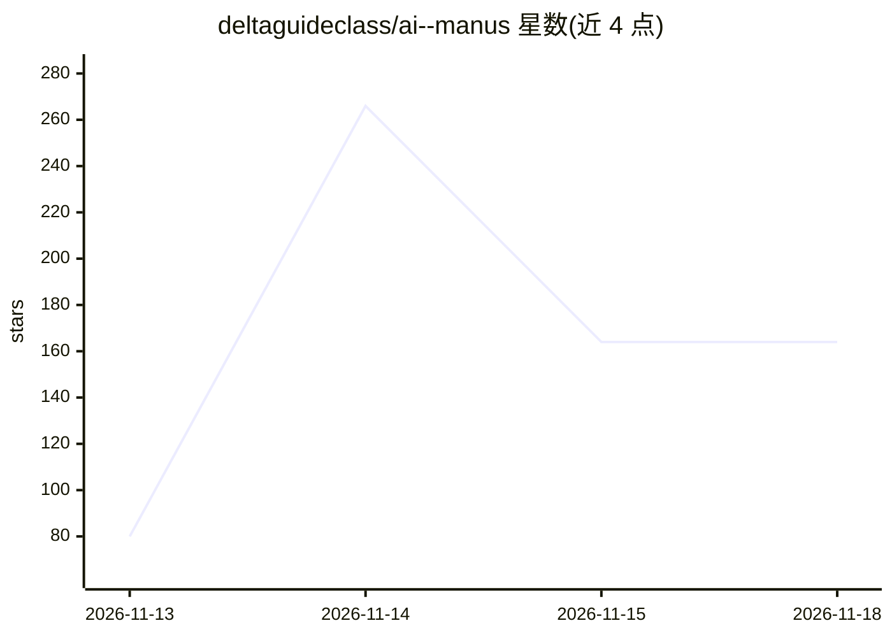

# deltaguideclass/ai--manus

⭐ 164 · Apache-2.0 · 推送 2026-11-15 · [GitHub](https://github.com/deltaguideclass/ai--manus) · 个人维护

**面向个人用户的自主 AI Agent：代为执行代码与浏览器操作**

Manus 是一个自主 AI Agent，宣称可代替用户编写并执行脚本、控制浏览器（导航网页、填写表单、采集信息）并执行多步骤任务，定位为家庭、学习与轻量办公场景的个人助手，而非企业平台。README 提供兼容性表（最低双核 CPU、4 GB 内存）与上手步骤说明（配置、测试、逐步扩展任务范围），但未给出具体安装命令、技术架构、模型接入方式或代码仓库内容，实质实现细节无法从 README 验证。

## 筛选速览

| 维度 | 判定 | 备注 |
|---|---|---|
| AI 角色 | `ai-native` | 本体是模型或模型工具 |
| 许可风险 | `permissive` | Apache-2.0 |
| 部署形态 | `None` |  |
| 模型依赖 | — | README 未给出锁定关系 |
| 硬件要求 | — | 无带数字的原话,不猜 |
| 安装摩擦 | `low` | 无编译、无系统依赖或容器化 |
| 成熟度 | — | 结构信号不足 |

## 能力要点

- 自主执行代码与浏览器控制（导航、填表、采集）
- 脚本与浏览器动作可在同一任务流中衔接
- 跨会话保持任务模式，可后台执行
- README 给出最低/推荐硬件兼容表

## 适用场景

- 让学生整理研究资料、运行小型脚本
- 远程工作者从多个网页收集数据并汇总
- 把重复性的小型日常任务交给后台代理执行

## 场景标签

`AI 助手` `浏览器自动化` · 领域:效率与自动化

## 证据(README 行号)

> L10: - **Autonomous Code Execution:** Manus AI agent runs code on its own to complete tasks, so you can focus on decisio
> L18: Manus is an autonomous AI agent designed to run code and control a browser on your behalf. Instead of acting like a

## 星数曲线

2026-11-13 80 → 2026-11-18 164（+84）

---
*卡片 v1 · prompt 1.4 · 生成 2026-11-17 · 置信度 low · 依据 README sha `0f78ee3a5dd2` · [字段定义](../../DATASET.md)*
