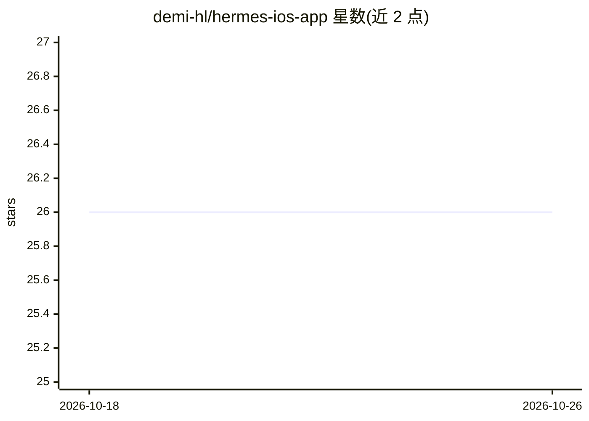

# demi-hl/hermes-ios-app

⭐ 26 · TypeScript · MIT · 推送 2026-06-25 · [GitHub](https://github.com/demi-hl/hermes-ios-app) · 个人维护

**本地 Hermes agent 的桌面+移动驾驶舱客户端**

为已在本机运行的 Hermes agent 提供的图形化驾驶舱：单一 Next.js 代码库经 Electron 打包为桌面应用、经 Capacitor 打包为 iOS 应用，通过自有 Tailscale 网络访问，不向第三方发送数据。功能包括 token 流式聊天（ACP）、本地 git 仓库与 worktree 工作区管理、多机 agent 舰队探测（SSH 限定只读白名单）、git 备份的 Obsidian 共享库、看板、终端、编辑器与 diff。需先本机安装 Hermes，桌面端提供 Linux/macOS/Windows 未签名安装包，也可 npm 源码构建。

## 筛选速览

| 维度 | 判定 | 备注 |
|---|---|---|
| AI 角色 | `ai-ecosystem` | LLM/agent 周边工具 |
| 许可风险 | `permissive` | MIT |
| 部署形态 | `desktop` | 安装包/桌面程序 |
| 模型依赖 | — | README 未给出锁定关系 |
| 硬件要求 | — | 无带数字的原话,不猜 |
| 安装摩擦 | `low` | 无编译、无系统依赖或容器化 |
| 成熟度 | — | 结构信号不足 |

## 能力要点

- 一份 Next.js 代码同时产出 Electron 桌面端与 Capacitor iOS 端
- 通过自有 Tailscale 访问，数据不经第三方
- Fleet 多机 agent 探测与可选 GPU/CPU 只读遥测（SSH 限定只读白名单）
- git 备份的 Obsidian 共享库，显示提交作者与同步状态

## 适用场景

- 给本机运行的 Hermes agent 配一个聊天和任务管理界面
- 在手机上通过 Tailscale 管理家里机器上的 agent
- 多台机器的 agent 统一监控和笔记共享

## 场景标签

`知识库管理` · 领域:知识与检索

## 证据(README 行号)

> L3: An alternative launcher for your local Hermes agent — a
> L4: desktop + mobile cockpit for the agent already running on your machine. Chat, repos, fleet, kanban,
> L34: - **Chat** — live token-streaming chat with your agent (ACP), one session per repo.

## 星数曲线

2026-10-18 26 → 2026-10-26 26（+0）

---
*卡片 v1 · prompt 1.4 · 生成 2026-10-26 · 置信度 high · 依据 README sha `1c28a152725e` · [字段定义](../../DATASET.md)*
