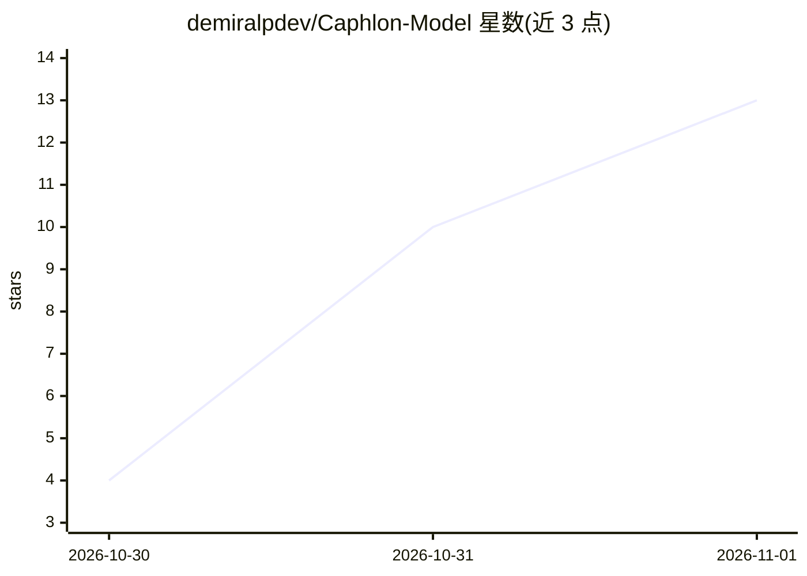

# demiralpdev/Caphlon-Model

⭐ 13 · HTML · Apache-2.0 · 推送 2026-10-28 · [GitHub](https://github.com/demiralpdev/Caphlon-Model) · [官网](https://demiralpdev.github.io/Caphlon-Model/) · 个人维护

**Qwen 3.8 27B 的 6.87 GiB GGUF 轻量版模型权重**

基于 Qwen 3.8 27B 的单文件 GGUF 量化模型：通过词表裁剪（100k 目标）与删除第 12-15 层的层级剪枝，将体积压至 6.87 GiB，声明不做蒸馏、保留 27B 拓扑。README 给出在 llama.cpp 上的运行命令、自测基准（HumanEval 29/30、MMLU 344/502）及硬件需求表（8 GB RAM/VRAM 起步）。权重托管于 Hugging Face，附 GitHub Release 与 Kaggle 镜像，评测脚本可复现。需注意基准由作者自行测得。

## 筛选速览

| 维度 | 判定 | 备注 |
|---|---|---|
| AI 角色 | `ai-native` | 本体是模型或模型工具 |
| 许可风险 | `permissive` | Apache-2.0 |
| 部署形态 | `None` |  |
| 模型依赖 | local-ok | 支持本地模型 |
| 硬件要求 | `gpu-8g` | |
| 安装摩擦 | `low` | 无编译、无系统依赖或容器化 |
| 成熟度 | — | 结构信号不足 |

## 能力要点

- 词表裁剪+层级剪枝实现 6.87 GiB 单文件 GGUF，声明无蒸馏
- 混合架构：gated-delta-net 多数层 + 全注意力少数层，KV cache 仅存全注意力层
- 提供 llama.cpp 运行命令与可复现评测脚本（eval-en40.sh）
- 权重托管 Hugging Face，附 GitHub Release 分卷与 Kaggle 镜像

## 适用场景

- 在 8 GB 内存笔记本或 8 GB 显存 GPU 上本地运行 27B 级模型
- 离线环境下的代码生成与英文推理
- 用 llama.cpp / llama-server 搭建本地单用户推理服务

## 场景标签

 · 领域:LLM 模型/本地推理

## 证据(README 行号)

> L15: **Caphlon-Model** is a compact, runnable build of **Qwen 3.8 27B** produced by reducing *representation redundancy*
> L27: |**Format**|GGUF (llama.cpp)|

## 星数曲线

2026-10-30 4 → 2026-11-01 13（+9）

---
*卡片 v1 · prompt 1.4 · 生成 2026-10-31 · 置信度 high · 依据 README sha `d93561ab0b19` · [字段定义](../../DATASET.md)*
