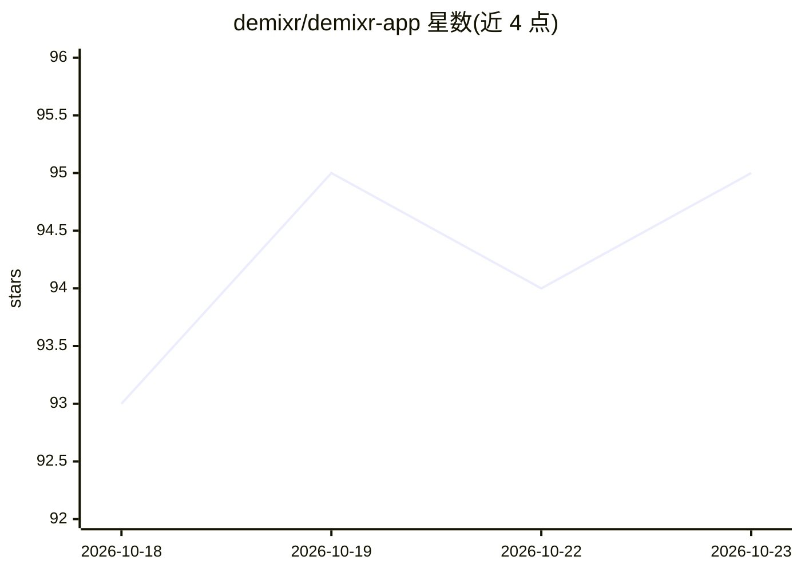

# demixr/demixr-app

⭐ 95 · Dart · MIT · 推送 2026-07-15 · [GitHub](https://github.com/demixr/demixr-app) · [官网](https://demixr.github.io/) · 组织维护

**手机/桌面端本地音乐源分离应用：拆分人声贝斯鼓等音轨**

基于 Flutter 的跨平台音乐源分离应用，在 Android、iOS 与 macOS 上本地运行 Demucs v4 (htdemucs) 模型，将歌曲分离为 Vocals、Bass、Drums、Other 四轨。支持从设备加载 mp3/wav 或从 YouTube 下载歌曲，提供分轨本地库与可对各轨静音的播放器。模型提供 ExecuTorch（CoreML/Vulkan，GPU）与 ONNX Runtime（CPU）两种后端，首次使用时下载；6-stem 变体因吉他钢琴分离质量不佳被排除。Android 提供 APK，macOS 提供 dmg，iOS 已实现但因苹果开发者账号费用未发布。项目自述仍在开发中。

## 筛选速览

| 维度 | 判定 | 备注 |
|---|---|---|
| AI 角色 | `ai-native` | 本体是模型或模型工具 |
| 许可风险 | `permissive` | MIT |
| 部署形态 | `desktop` | 安装包/桌面程序 |
| 模型依赖 | — | README 未给出锁定关系 |
| 硬件要求 | — | 无带数字的原话,不猜 |
| 安装摩擦 | `low` | 无编译、无系统依赖或容器化 |
| 成熟度 | `idea` | |

## 能力要点

- Demucs v4 (htdemucs) 模型在移动端本地运行，分离 4 轨音源
- 双后端可选：ExecuTorch GPU（CoreML/Vulkan）或 ONNX Runtime CPU
- 支持设备本地 mp3/wav 与 YouTube 歌曲下载，含分轨播放器
- 跨平台：Android/macOS 可下载安装，iOS 已实现在设备运行

## 适用场景

- 把自己喜欢的歌曲拆成人声/伴奏等分轨用于练习或 remix
- 在手机上离线做音乐源分离，不依赖服务器
- 播放时单独静音某条音轨（如去人声听伴奏）

## 场景标签

 · 领域:音频/音乐技术

## 证据(README 行号)

> L3: > Music source separation on mobile
> L33: The **demixing** uses Demucs v4 (htdemucs),

## 星数曲线

2026-10-18 93 → 2026-10-23 95（+2）

---
*卡片 v1 · prompt 1.4 · 生成 2026-10-23 · 置信度 high · 依据 README sha `ffd87bc3d9a4` · [字段定义](../../DATASET.md)*
