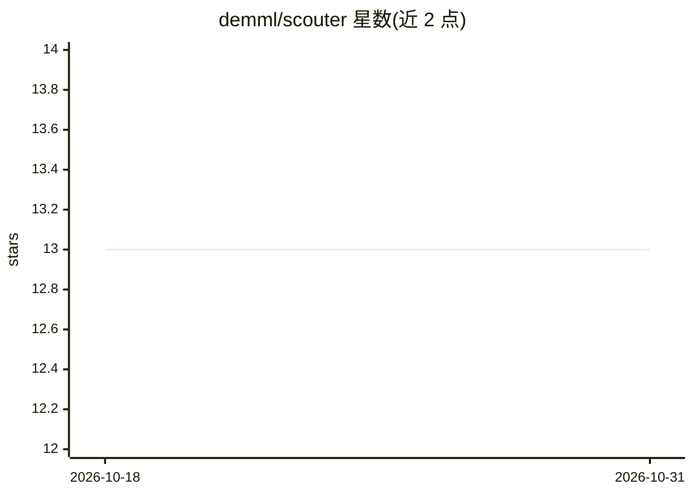

# demml/scouter

⭐ 13 · Rust · MIT · 推送 2026-05-15 · [GitHub](https://github.com/demml/scouter) · [官网](https://docs.demml.io/scouter) · 组织维护

**面向开发者的 ML/AI 应用监控、观测与 Agent 评测工具包**

Rust 编写、经 PyO3 以 Python 库形式暴露的监控与可观测性工具包，采用客户端/服务器架构：Python 客户端嵌入应用采集数据，服务器基于 Postgres 做数据存储、漂移计算、追踪与评测。功能覆盖 PSI 等漂移检测、OpenTelemetry 兼容的分布式追踪、离线/在线一致的 Agent 评测（规则断言、LLM 评审、Trace 断言三类原语），并内置 Slack/OpsGenie 告警。支持 Kafka/RabbitMQ/Redis 事件传输与 AWS/GCP/Azure。

## 筛选速览

| 维度 | 判定 | 备注 |
|---|---|---|
| AI 角色 | `ai-ecosystem` | LLM/agent 周边工具 |
| 许可风险 | `permissive` | MIT |
| 部署形态 | `library` | 以包/库形式分发 |
| 模型依赖 | — | README 未给出锁定关系 |
| 硬件要求 | — | 无带数字的原话,不猜 |
| 安装摩擦 | `low` | 无编译、无系统依赖或容器化 |
| 成熟度 | — | 结构信号不足 |

## 能力要点

- PSI 漂移检测与自定义指标监控
- OpenTelemetry 兼容的分布式追踪（可转发外部 OTEL collector）
- 三类评测原语：AssertionTask（50+ 比较算子）、LLMJudgeTask、TraceAssertionTask
- 离线/在线评测同构：同一任务定义既做回归测试又做生产监控

## 适用场景

- 给生产环境 ML/AI 服务做数据与模型漂移监控
- Agent 上线前跑离线回归评测、上线后持续监控
- 用 LLM 评审对回答质量与幻觉做语义评估并接入告警

## 场景标签

`LLM 可观测性` `模型评测` · 领域:评测与运维

## 证据(README 行号)

> L11: `Scouter` is a developer-first monitoring and observability toolkit for ML and AI workflows. It covers the full spe

## 星数曲线

2026-10-18 13 → 2026-10-31 13（+0）

---
*卡片 v1 · prompt 1.4 · 生成 2026-10-31 · 置信度 high · 依据 README sha `2ce848a0e33f` · [字段定义](../../DATASET.md)*
