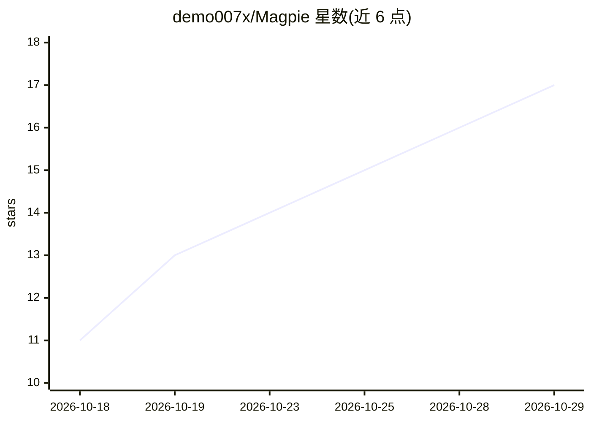

# demo007x/Magpie

⭐ 17 · TypeScript · MIT · 推送 2026-10-28 · [GitHub](https://github.com/demo007x/Magpie) · [官网](https://demo007x.github.io/Magpie/) · 个人维护 · 中文 README

**macOS/Windows 划词即译、解释、摘要的 AI 阅读工具**

基于 Tauri 2 + Rust + React 的桌面文本选中工具：在任意应用中划选文字或截屏取词，弹出悬浮条，流式输出 AI 翻译/解释/摘要，并自动识别链接、电话、日期等实体；结果可写入 Obsidian 或日历。OCR 在本地设备上完成，模型服务由用户自带 API key（BYOK），支持十个预设与任意 OpenAI 兼容端点，另含九种机器翻译引擎。macOS 需授予辅助功能权限，Windows 无需授权；API key 目前以明文存于本地 settings.json（计划迁移到系统钥匙串）。

## 筛选速览

| 维度 | 判定 | 备注 |
|---|---|---|
| AI 角色 | `ai-native` | 本体是模型或模型工具 |
| 许可风险 | `permissive` | MIT |
| 部署形态 | `None` |  |
| 模型依赖 | locked-api |  |
| 硬件要求 | — | 无带数字的原话,不猜 |
| 安装摩擦 | `low` | 无编译、无系统依赖或容器化 |
| 成熟度 | `idea` | |

## 能力要点

- 全局划词触发悬浮条，流式 AI 翻译/解释/摘要
- 本地 OCR 识别图片、视频、扫描件中的文字
- BYOK 模型服务：十家预设 + 任意 OpenAI 兼容端点
- 结果直接写入 Obsidian 或预填日历事件

## 适用场景

- 阅读外文内容时划词即译、即解释，不用切换应用
- 把图片、视频、扫描件里的文字取出来翻译或摘要
- 一键把选中内容存入 Obsidian 或创建日历事件

## 场景标签

`OCR` `AI 助手` · 领域:对话与助手

## 证据(README 行号)

> L19: **Magpie (拾趣)** is a text-selection AI tool: select text in *any* app on macOS or Windows, or capture a region of t
> L51: - **Eleven actions** — Translate / Explain / Summarize (AI-generated, streamed) + Copy / Search / Open Link / Compo
> L60: - **BYOK model services** — bring your own API key; one-click presets for DeepSeek, Volcengine (Doubao), Zhipu, Kim

## 星数曲线

2026-10-18 11 → 2026-10-29 17（+6）

---
*卡片 v1 · prompt 1.4 · 生成 2026-10-29 · 置信度 high · 依据 README sha `60258054a768` · [字段定义](../../DATASET.md)*
