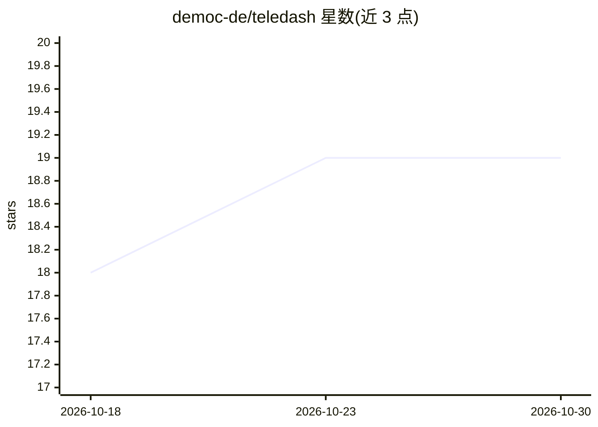

# democ-de/teledash

⭐ 19 · 推送 2025-12-04 · [GitHub](https://github.com/democ-de/teledash) · 组织维护

**面向研究与调查的 Telegram 内容搜索分析 Web 应用**

由 democ-de 开发的 Telegram 研究分析 Web 应用：绑定一个或多个 Telegram 账号后周期性下载并处理频道、群组与聊天内容。功能包括多参数搜索消息、对图片做 OCR 文字识别、对语音消息后台 ASR 转录为可搜索文本（识别模型可手动改进或自行训练）、频道/群组活动与增长的统计指标采集。媒体可存入 MinIO 或 S3 兼容存储，数据可通过 REST API（Swagger 可测试）访问，支持 mongoexport 导出 CSV/JSON。面向新闻调查与科研场景，私人对话不会被采集。

## 筛选速览

| 维度 | 判定 | 备注 |
|---|---|---|
| AI 角色 | `ai-native` | 本体是模型或模型工具 |
| 许可风险 | `none` | — |
| 部署形态 | `None` |  |
| 模型依赖 | — | README 未给出锁定关系 |
| 硬件要求 | — | 无带数字的原话,不猜 |
| 安装摩擦 | `low` | 无编译、无系统依赖或容器化 |
| 成熟度 | — | 结构信号不足 |

## 能力要点

- 图片 OCR 文字识别与语音消息 ASR 后台转录为可搜索文本
- 频道/群组活动与增长统计指标的定期采集
- 媒体自动存储到 MinIO 或 S3 兼容云存储
- REST API + Swagger 访问与过滤全部采集数据

## 适用场景

- 调查记者按时间段、频道、用户检索 Telegram 消息
- 研究人员对频道活动与增长做定量分析
- 将采集数据经 API 导出供第三方软件处理

## 场景标签

`科研工具` `数据分析` · 领域:效率与自动化

## 证据(README 行号)

> L6: Teledash is a web application that simplifies research and analysis of the content on Telegram.
> L22: Automated text recognition (OCR) is used to recognize and save text on images. In addition, voice messages can auto

## 星数曲线

2026-10-18 18 → 2026-10-30 19（+1）

---
*卡片 v1 · prompt 1.4 · 生成 2026-10-28 · 置信度 mid · 依据 README sha `bab68d6b5618` · [字段定义](../../DATASET.md)*
