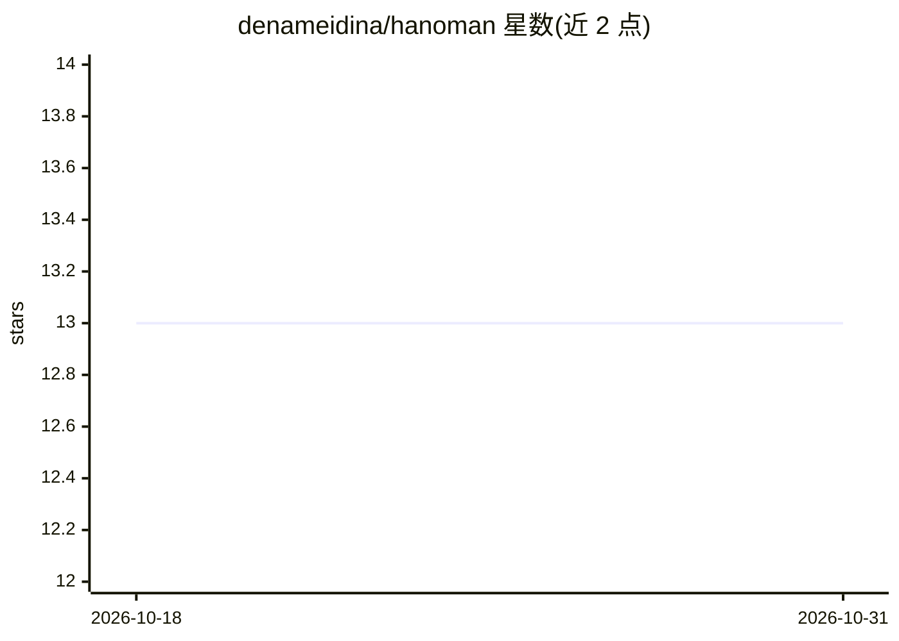

# denameidina/hanoman

⭐ 13 · TypeScript · MIT · 推送 2026-10-30 · [GitHub](https://github.com/denameidina/hanoman) · [官网](https://nafanesia.id/) · 个人维护

**多项目并行运行与监控 coding agent 的编排器+仪表盘**

面向文档驱动开发的 orchestrator + dashboard：将 brief、QA、GitHub issue 或目标转化为交互式 agent 会话（Claude Code 或 Codex CLI），在隔离的 git worktree 中按 backlog 逐项执行，每个项目文档（internal/docs/**）作为 Source of Truth。提供 Overview、Backlog、Terminal（tmux + xterm.js 流式）、Scheduler、VPS 运维等十余个界面，支持 MCP（17 个 tool）、Telegram 控制、agent token API 与多设备同步。npm 全局安装，数据存于内嵌 SQLite，系统需 git、tmux、curl 与已登录的 agent CLI。

## 筛选速览

| 维度 | 判定 | 备注 |
|---|---|---|
| AI 角色 | `ai-ecosystem` | LLM/agent 周边工具 |
| 许可风险 | `permissive` | MIT |
| 部署形态 | `library` | 以包/库形式分发 |
| 模型依赖 | locked-api |  |
| 硬件要求 | — | 无带数字的原话,不猜 |
| 安装摩擦 | `low` | 无编译、无系统依赖或容器化 |
| 成熟度 | — | 结构信号不足 |

## 能力要点

- 一个 backlog = 一个会话，在独立 git worktree 中隔离执行
- tmux + xterm.js 实时观看、操控与中断 agent 终端会话
- MCP 提供 17 个 tool，另有 agent token API 与 Telegram 控制
- 文档作为 Source of Truth，索引并监控文档漂移

## 适用场景

- 同时在多个项目上并行驱动 coding agent 处理 backlog
- 从 Telegram 或仪表盘实时监控并干预 agent 会话
- 以项目文档为准绳组织头脑风暴到执行的完整流程

## 场景标签

`编码 Agent` · 领域:编码与开发

## 证据(README 行号)

> L19: hanoman adalah **orchestrator + dashboard** untuk pengembangan yang digerakkan dokumentasi.
> L22: (Claude Code atau Codex)

## 星数曲线

2026-10-18 13 → 2026-10-31 13（+0）

---
*卡片 v1 · prompt 1.4 · 生成 2026-10-31 · 置信度 high · 依据 README sha `f63ab204149e` · [字段定义](../../DATASET.md)*
