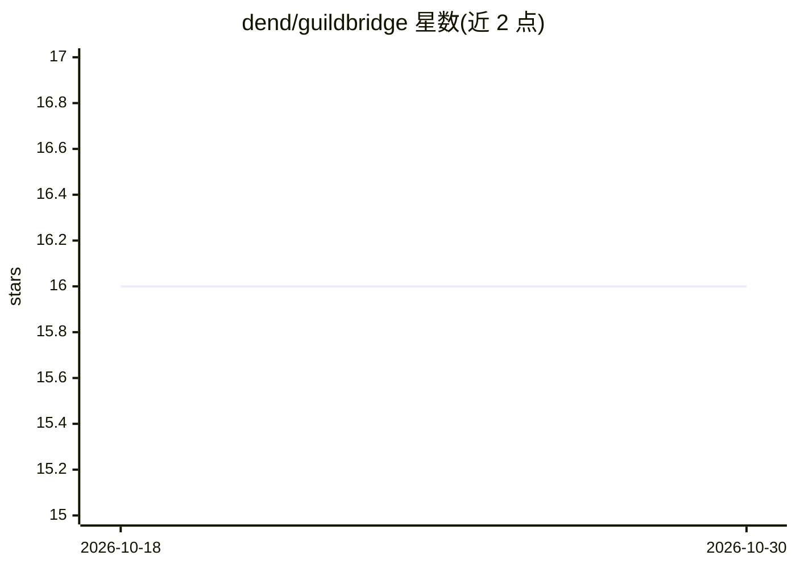

# dend/guildbridge

⭐ 16 · TypeScript · MIT · 推送 2026-09-07 · [GitHub](https://github.com/dend/guildbridge) · 个人维护

**部署在 Cloudflare Workers 上的 Discord 远程 MCP 服务器**

面向 MCP 客户端的远程 MCP 服务器，让 AI agent 经 Discord OAuth2 认证后读取、搜索与发送 Discord 消息。提供 7 个工具（列出服务器/频道、读消息、搜索、发送、回复），服务端实现 RBAC，用 bot token 调用 Discord API，用户 OAuth token 仅用于身份验证。提供 Cloudflare Terraform 或 wrangler CLI 两种部署方式，依赖 KV、D1 与 Zero Trust Access；每次工具调用写入审计日志。官方托管版仅限特定账户，需自行部署。

## 筛选速览

| 维度 | 判定 | 备注 |
|---|---|---|
| AI 角色 | `ai-ecosystem` | LLM/agent 周边工具 |
| 许可风险 | `permissive` | MIT |
| 部署形态 | `library` | 以包/库形式分发 |
| 模型依赖 | — | README 未给出锁定关系 |
| 硬件要求 | — | 无带数字的原话,不猜 |
| 安装摩擦 | `low` | 无编译、无系统依赖或容器化 |
| 成熟度 | — | 结构信号不足 |

## 能力要点

- 7 个 Discord 工具：读消息、搜索、发送、回复等
- 服务端 RBAC 与 bot/用户双 token 分离机制
- 每次 MCP 调用双写 D1 审计日志与 Analytics Engine 指标
- Terraform 一键或 wrangler CLI 手动部署到 Cloudflare Workers

## 适用场景

- 让 AI agent 在 MCP 社区 Discord 频道读取和回复消息
- 自建带权限控制的 Discord MCP 服务器供团队 agent 使用
- 通过管理面板在运行时维护允许的 Discord 用户白名单

## 场景标签

`Agent 框架` · 领域:Agent 开发

## 证据(README 行号)

> L3:  A remote MCP server for Discord, deployed on Cloudflare Workers.
> L17: There is no official Discord MCP server, yet much of the coordination with contributors in the MCP community happen

## 星数曲线

2026-10-18 16 → 2026-10-30 16（+0）

---
*卡片 v1 · prompt 1.4 · 生成 2026-10-30 · 置信度 high · 依据 README sha `5efb1becfdc7` · [字段定义](../../DATASET.md)*
