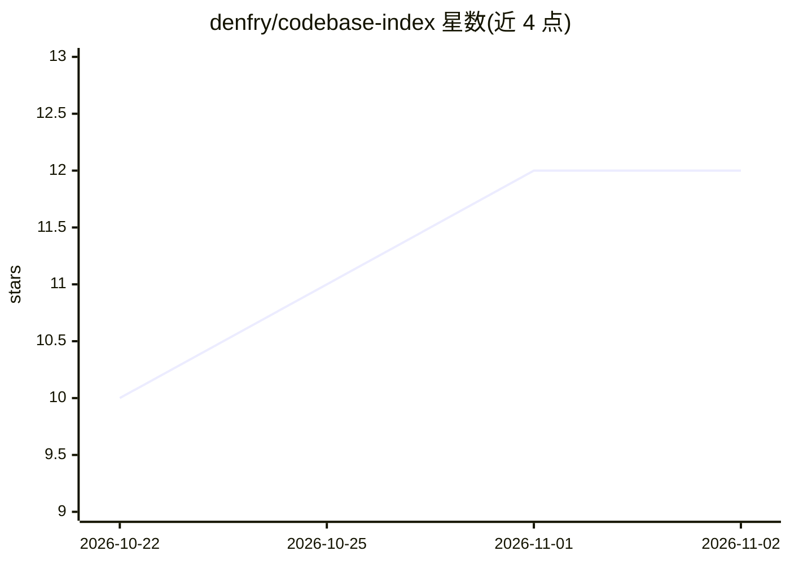

# denfry/codebase-index

⭐ 12 · Python · MIT · 推送 2026-10-05 · [GitHub](https://github.com/denfry/codebase-index) · 个人维护

**给 AI 编程 agent 用的本地代码索引：查找、追踪、影响预测**

面向 AI 编程 agent 的本地代码地图工具：基于 Tree-sitter 提取 12 种语言的符号与依赖边，存入带 FTS5 的 SQLite 单文件索引，通过意图检测、多路检索、RRR 融合与重排，回答“X 在哪实现/谁调用它/改它会破坏什么”，结果带 file:line 证据、置信度与图覆盖标注。提供 CLI、Claude Code/Codex/OpenCode 集成与 MCP 服务器三种交付面，默认无网络、无遥测，密钥文件排除在索引外且输出时再脱敏。

## 筛选速览

| 维度 | 判定 | 备注 |
|---|---|---|
| AI 角色 | `ai-ecosystem` | LLM/agent 周边工具 |
| 许可风险 | `permissive` | MIT |
| 部署形态 | `self-host` | docker 或自建部署 |
| 模型依赖 | — | README 未给出锁定关系 |
| 硬件要求 | — | 无带数字的原话,不猜 |
| 安装摩擦 | `low` | 无编译、无系统依赖或容器化 |
| 成熟度 | — | 结构信号不足 |

## 能力要点

- Tree-sitter 符号与调用/继承边提取，SQLite+FTS5 单文件本地索引
- Find/Trace/Predict 三类查询均带 file:line 证据、置信度与部分图标注
- CLI、agent 技能与 MCP 服务器共用同一服务层，11 个 MCP 工具
- 默认无网络无遥测；密钥不入索引、输出时再脱敏，doctor --strict 可审计

## 适用场景

- 让 Claude Code / Codex / OpenCode 等 agent 在大仓库中先查索引再读文件，减少误读
- 评估一次改动或当前 diff 的上下游影响范围
- 本地检索代码定义与引用路径，代码不出本机

## 场景标签

 · 领域:开发者工具/代码智能

## 证据(README 行号)

> L5:  A local code map for AI coding agents: find the right file, trace how it connects, predict what a change breaks.
> L126: |**Any MCP client** (Claude Desktop, Cursor, VS Code, Zed, Windsurf, ...)|`pip install "codebase-index[mcp]"` then
> L173:  Architecture: discovery and secret gates, Tree-sitter symbols and edges, local SQLite with FTS5, one service laye

## 星数曲线

2026-10-22 10 → 2026-11-02 12（+2）

---
*卡片 v1 · prompt 1.4 · 生成 2026-11-01 · 置信度 mid · 依据 README sha `2c6696eca72a` · [字段定义](../../DATASET.md)*
