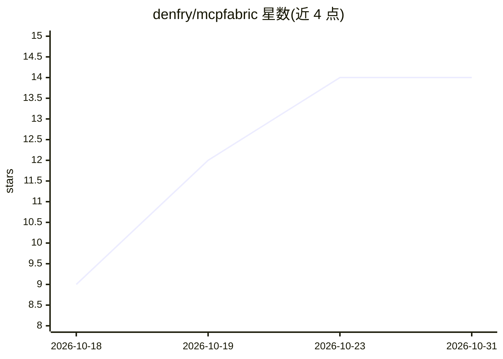

# denfry/mcpfabric

⭐ 14 · Java · MIT · 推送 2026-10-26 · [GitHub](https://github.com/denfry/mcpfabric) · [官网](https://modrinth.com/mod/mcpfabric) · 个人维护

**让 AI agent 通过 MCP 观察并操控 Minecraft 的模组+服务器**

由两部分组成：嵌入 Minecraft 的 Fabric/NeoForge 模组（内置仅监听 127.0.0.1 的 HTTP 桥，bearer token 认证），以及将其封装为 50+ 可发现工具的 TypeScript MCP 服务器。AI agent 可通过自然语言移动、挖掘、建造、战斗、管理背包、截图、执行管理员命令与后台任务（导航用 A*，含持久记忆与目标树的 agent runtime）。支持 Claude Desktop、Claude Code 及其他 MCP 客户端，覆盖 Minecraft 1.21.1–1.21.11 与 26.1–26.3。安全上通过 enable* 开关与监督模式限制危险能力组。

## 筛选速览

| 维度 | 判定 | 备注 |
|---|---|---|
| AI 角色 | `ai-ecosystem` | LLM/agent 周边工具 |
| 许可风险 | `permissive` | MIT |
| 部署形态 | `library` | 以包/库形式分发 |
| 模型依赖 | locked-api |  |
| 硬件要求 | — | 无带数字的原话,不猜 |
| 安装摩擦 | `medium` | 含编译或系统依赖之一 |
| 成熟度 | — | 结构信号不足 |

## 能力要点

- 模组 HTTP 桥 + TypeScript MCP 服务器双层架构，50+ 工具
- 客户端玩家控制（KeyMapping 集成、A* 导航）与服务端管理员操作
- 带持久记忆、目标树与后台任务的 agent runtime
- 默认回环地址 + bearer token + 能力组开关与监督模式

## 适用场景

- 让 Claude 等 MCP 客户端直接玩我的 Minecraft 存档
- AI 作为管理员运维专用服务器（执行命令、管理实体与玩家）
- 测试与自动化验证其他模组的 UI 与行为

## 场景标签

`GUI 自动化` · 领域:效率与自动化

## 证据(README 行号)

> L21: MCP Fabric is a local-first Minecraft mod and Model Context Protocol server that gives AI agents
> L48: `mcpfabric` has two parts: a Fabric / NeoForge mod that embeds a local HTTP bridge in Minecraft, and a small
> L49: TypeScript MCP server that exposes the bridge as discoverable tools.

## 星数曲线

2026-10-18 9 → 2026-10-31 14（+5）

---
*卡片 v1 · prompt 1.4 · 生成 2026-10-31 · 置信度 high · 依据 README sha `a6285b4a47db` · [字段定义](../../DATASET.md)*
