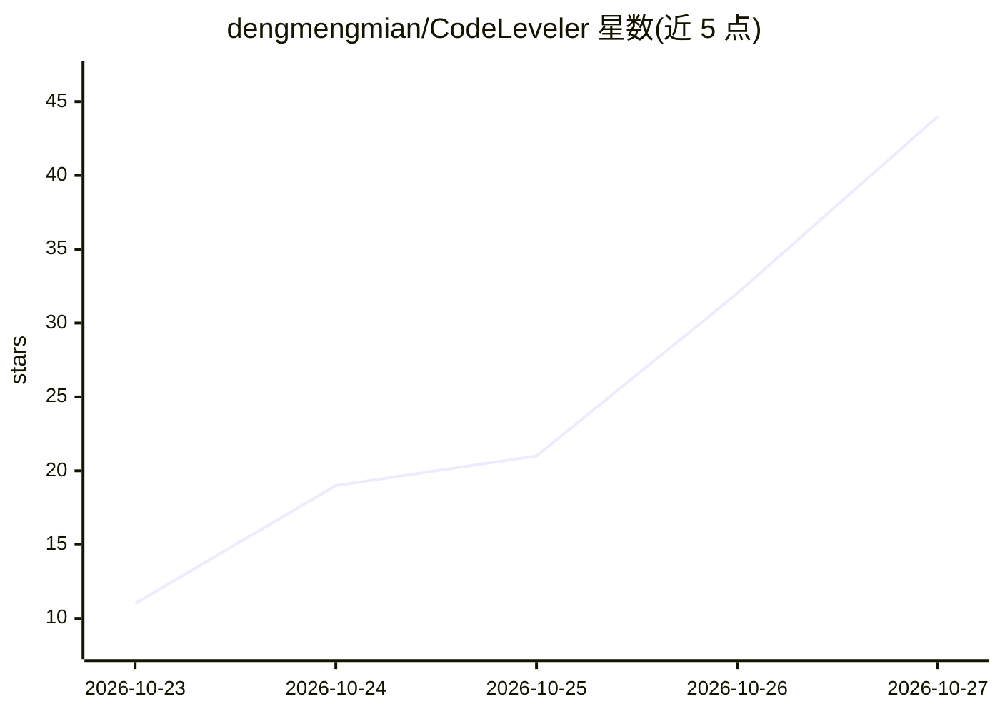

# dengmengmian/CodeLeveler

⭐ 44 · Rust · Apache-2.0 · 推送 2026-10-20 · [GitHub](https://github.com/dengmengmian/CodeLeveler) · 个人维护 · 中文 README

**本地优先的编码 agent：在仓库中执行任务并留下可审查的变更**

以 Rust 实现的本地优先编码 agent，提供终端 UI（leveler）、Web UI 与 headless CLI，三者共用同一运行时。接受任务后可读取仓库、编辑文件、运行构建测试、使用 Git，产出可检查的代码变更；会话状态持久化到本机，可 resume/trace 续接。支持智谱 BigModel、DeepSeek、Moonshot/Kimi、OpenAI、Anthropic 等 OpenAI 兼容端点；提供 /develop 工作流（分析→编码→验证→审查）、并行候选 worktree、基于 Seatbelt/bubblewrap 的权限隔离，以及带 SHA-256 校验的安装脚本、Homebrew 与二进制发布渠道。模型请求发往用户配置的 provider。

## 筛选速览

| 维度 | 判定 | 备注 |
|---|---|---|
| AI 角色 | `ai-native` | 本体是模型或模型工具 |
| 许可风险 | `permissive` | Apache-2.0 |
| 部署形态 | `desktop` | 安装包/桌面程序 |
| 模型依赖 | locked-api |  |
| 硬件要求 | — | 无带数字的原话,不猜 |
| 安装摩擦 | `low` | 无编译、无系统依赖或容器化 |
| 成熟度 | — | 结构信号不足 |

## 能力要点

- 终端/Web/headless CLI 三界面共用同一运行时，会话持久化可 resume
- 支持智谱 BigModel/DeepSeek/Moonshot/OpenAI/Anthropic 等 OpenAI 兼容端点
- /develop 工作流：Analyze → Coding → Verify → Review
- macOS Seatbelt / Linux bubblewrap 的权限隔离与审批机制

## 适用场景

- 让 agent 在我的仓库里找失败测试并修复，改动留给本人审查
- 用并行 worktree 同时生成多个候选实现再合并
- 通过 headless CLI 把编码任务接入脚本或流水线

## 场景标签

`编码 Agent` · 领域:编码与开发

## 证据(README 行号)

> L5:  A local-first coding agent that works in your repository and leaves reviewable changes when code needs to change.
> L10: Give CodeLeveler a task. It can read the repository, edit files, run builds and tests, and use Git. Conversations, 

## 星数曲线

2026-10-23 11 → 2026-10-27 44（+33）

---
*卡片 v1 · prompt 1.4 · 生成 2026-10-26 · 置信度 high · 依据 README sha `f28f02313da0` · [字段定义](../../DATASET.md)*
