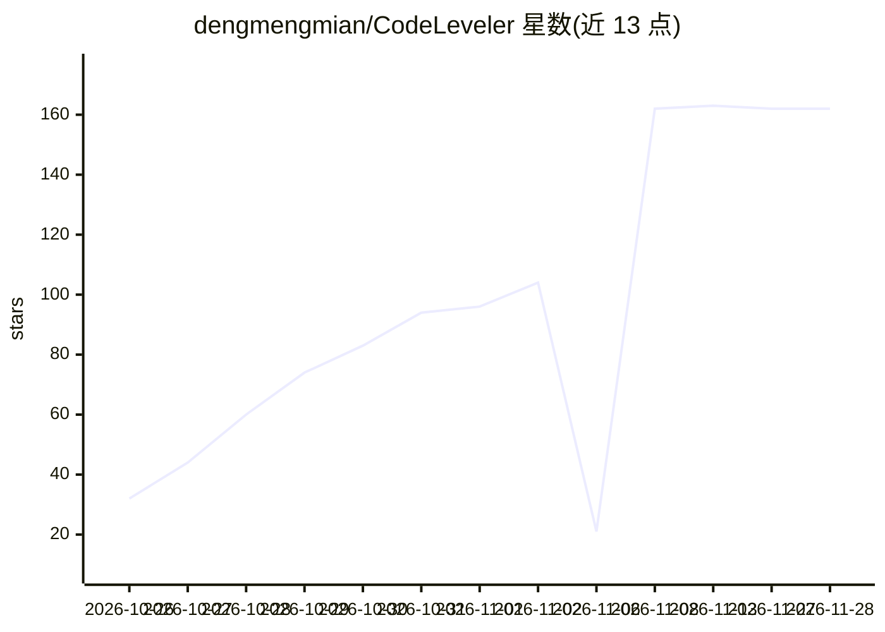

# dengmengmian/CodeLeveler

⭐ 162 · Rust · Apache-2.0 · 推送 2026-11-26 · [GitHub](https://github.com/dengmengmian/CodeLeveler) · 个人维护 · 中文 README

**在本地仓库工作的编码 agent CLI，留下可审查的改动**

用 Rust 编写的本地优先编码 agent：读取代码、编辑文件并运行测试，在终端 UI 中检查工具输出与 diff，支持稍后恢复会话或从 CLI 直接执行任务。权限分 Auto/Restricted/Full 三档，风险操作需批准；会话记录保存在本机。安装器覆盖 macOS（Apple Silicon/Intel）、Linux x86_64 与 Windows x86_64，提供 SHA-256 校验；模型接入通过 OpenAI 兼容接口或各官方 provider。

## 筛选速览

| 维度 | 判定 | 备注 |
|---|---|---|
| AI 角色 | `ai-native` | 本体是模型或模型工具 |
| 许可风险 | `permissive` | Apache-2.0 |
| 部署形态 | `desktop` | 安装包/桌面程序 |
| 模型依赖 | — | README 未给出锁定关系 |
| 硬件要求 | — | 无带数字的原话,不猜 |
| 安装摩擦 | `low` | 无编译、无系统依赖或容器化 |
| 成熟度 | — | 结构信号不足 |

## 能力要点

- 本地仓库内读取代码、编辑文件、运行测试并输出可审查 diff
- Auto/Restricted/Full 三档权限模式与受限命令沙箱（Linux 需 bubblewrap）
- 终端 UI 交互、CLI 一次性任务（leveler run）与会话恢复（resume）
- 支持 BigModel、DeepSeek、Moonshot/Kimi、OpenAI、Anthropic 及 OpenAI 兼容 provider

## 适用场景

- 让 agent 在本地项目里查找并修复失败的测试
- 在终端逐条检查工具调用与 diff 后再接受改动
- 在脚本中直接运行带验收标准的编码任务

## 场景标签

`编码 Agent` · 领域:编码与开发

## 证据(README 行号)

> L5:  A coding agent that works in your local repository
> L8: CodeLeveler reads code, edits files, and runs tests in your local workspace. Inspect tool output and diffs in the te
> L53: The default Auto mode allows ordinary development actions and asks for approval for risky operations. Restricted ap

## 星数曲线

2026-10-26 32 → 2026-11-28 162（+130）

---
*卡片 v1 · prompt 1.4 · 生成 2026-11-27 · 置信度 high · 依据 README sha `0ca694eb8f2a` · [字段定义](../../DATASET.md)*
