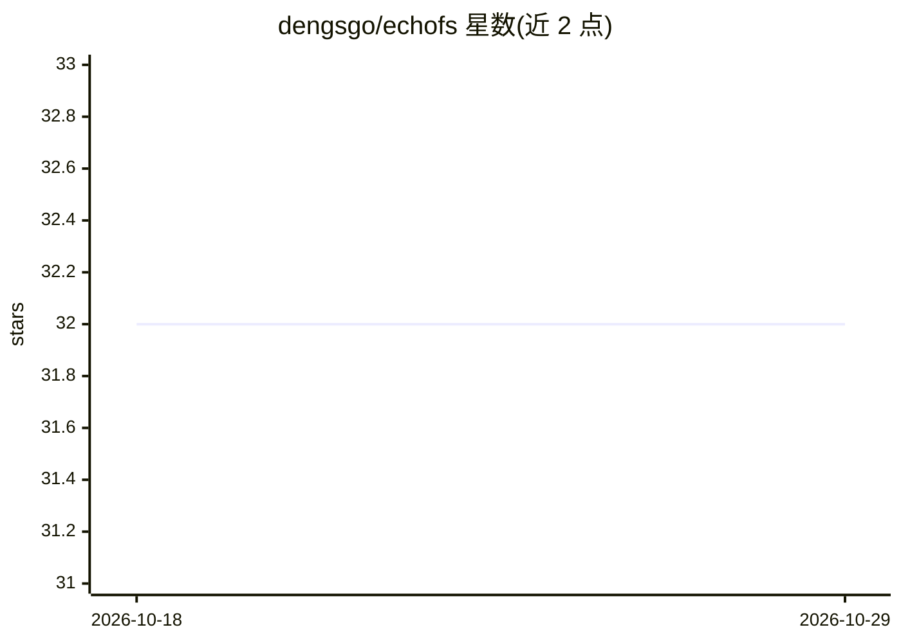

# dengsgo/echofs

⭐ 32 · Rust · Apache-2.0 · 推送 2026-10-11 · [GitHub](https://github.com/dengsgo/echofs) · 个人维护 · 中文 README

**把任意目录变成可分享、可挂载的 Web 站点的 Rust 文件服务器**

单二进制 Rust HTTP 文件服务器：将指定目录以 Web UI 形式发布，支持图片/音视频在线预览、链接与二维码分享、浏览器内文件管理，同时默认暴露读写 WebDAV，可在 Finder/Explorer/Nautilus 挂载为网络驱动器。面向个人与团队做文件共享、PC/手机互连和轻量 NAS 场景。提供预编译二进制与可选 egui 桌面控制面板（构建时启用 --features gui），支持 Basic Auth、限速、路径遍历防护、ZIP 流式下载等；本体无 AI 功能。中文文档与双语 GUI 可用。

## 筛选速览

| 维度 | 判定 | 备注 |
|---|---|---|
| AI 角色 | `ai-enhanced` | 去掉 AI 部分产品仍成立 |
| 许可风险 | `permissive` | Apache-2.0 |
| 部署形态 | `desktop` | 安装包/桌面程序 |
| 模型依赖 | — | README 未给出锁定关系 |
| 硬件要求 | — | 无带数字的原话,不猜 |
| 安装摩擦 | `medium` | 含编译或系统依赖之一 |
| 成熟度 | — | 结构信号不足 |

## 能力要点

- 单二进制、零运行时依赖，覆盖 Linux/macOS/Windows 多架构预编译包
- 读写 WebDAV 可挂载为网络驱动器，支持 11 种方法
- 内置响应式 Web UI：预览、管理、分享（链接/二维码）、三套主题
- 可选 egui 桌面控制面板（中英双语），macOS 提供 .dmg 应用包

## 适用场景

- 在局域网内与朋友或团队快速共享文件夹
- 把目录挂载为网络驱动器，当轻量 NAS 存放和串流影片
- 用手机文件管理器直接访问电脑上的文件

## 场景标签

 · 领域:文件共享/网络存储工具

## 证据(README 行号)

> L10: EchoFS is a lightweight HTTP file server written in Rust: it turns any directory into a tiny site with a modern web
> L17: - **Web UI** — Built-in modern responsive web UI with breadcrumb navigation, list/grid views, and sortable columns.

## 星数曲线

2026-10-18 32 → 2026-10-29 32（+0）

---
*卡片 v1 · prompt 1.4 · 生成 2026-10-26 · 置信度 low · 依据 README sha `c95b1a49fef6` · [字段定义](../../DATASET.md)*
