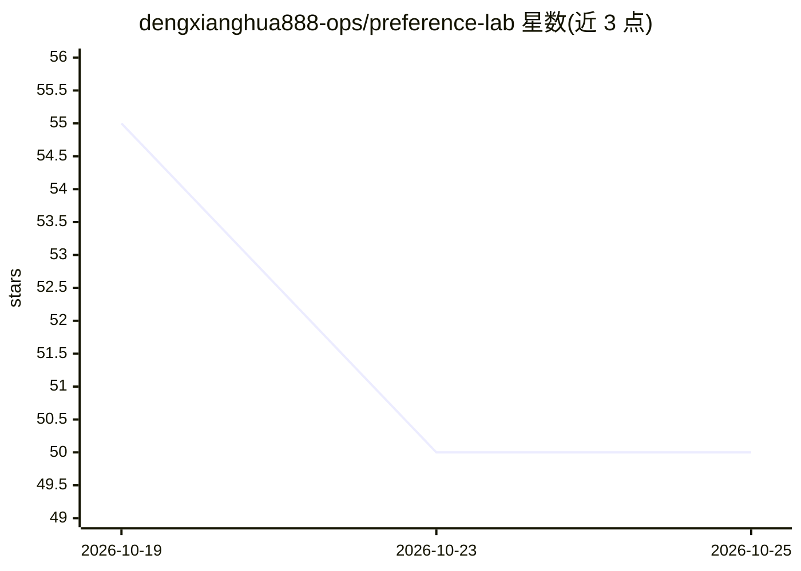

# dengxianghua888-ops/preference-lab

⭐ 50 · Python · Apache-2.0 · 推送 2026-10-22 · [GitHub](https://github.com/dengxianghua888-ops/preference-lab) · 个人维护 · 中文 README

**把内容审核策略转成可溯源偏好数据集的工具，供 ML/数据团队使用**

面向构建内容审核数据集的 ML 与数据团队：用户以声明式 PolicyPack 定义审核规则（语言、标签、证据要求、决策表），工具据此生成边界案例，比较候选回答，经证据与规则门控后导出 chosen/rejected 偏好对，可输出 TRL 或 ShareGPT 格式并附带原文、Unicode 证据位置与策略哈希。支持 SQLite 断点续跑、预算上限与价格快照，live 模式调用用户配置的模型提供商并可能产生费用；录制 demo 不调用外部模型、无需 API key。当前为 Alpha 阶段，未发布到 PyPI，仅源码或 GitHub Releases wheel 安装；数据集许可未指明。

## 筛选速览

| 维度 | 判定 | 备注 |
|---|---|---|
| AI 角色 | `ai-ecosystem` | LLM/agent 周边工具 |
| 许可风险 | `permissive` | Apache-2.0 |
| 部署形态 | `library` | 以包/库形式分发 |
| 模型依赖 | — | README 未给出锁定关系 |
| 硬件要求 | — | 无带数字的原话,不猜 |
| 安装摩擦 | `low` | 无编译、无系统依赖或容器化 |
| 成熟度 | `idea` | |

## 能力要点

- 声明式 PolicyPack（固定词表、不可执行代码）驱动案例生成与门控
- 导出 TRL 标准/对话格式与 LLaMA-Factory ShareGPT 格式，附带溯源信息
- SQLite 检查点支持断点续跑，未知远程请求需显式决策
- live 模式强制预算上限与模型价格快照，用量与预留可见

## 适用场景

- 为新审核策略生成边界案例并检查分歧与弃权
- 将误判或漏判决策回溯到原文与证据片段
- 导出带溯源的候选 DPO 训练数据供后续人工审核

## 场景标签

 · 领域:LLM 训练数据/内容审核

## 证据(README 行号)

> L5: For ML and data teams building content moderation datasets: define your rules, generate boundary cases, and export c
> L19: |Prepare candidate DPO data|Export chosen/rejected responses in TRL or ShareGPT format, with provenance for later r
> L70: - **Account for every attempt.** Live runs require a budget cap and model price snapshot. Retries, usage estimates 

## 星数曲线

2026-10-19 55 → 2026-10-25 50（-5）

---
*卡片 v1 · prompt 1.4 · 生成 2026-10-24 · 置信度 mid · 依据 README sha `1fce1a80f114` · [字段定义](../../DATASET.md)*
