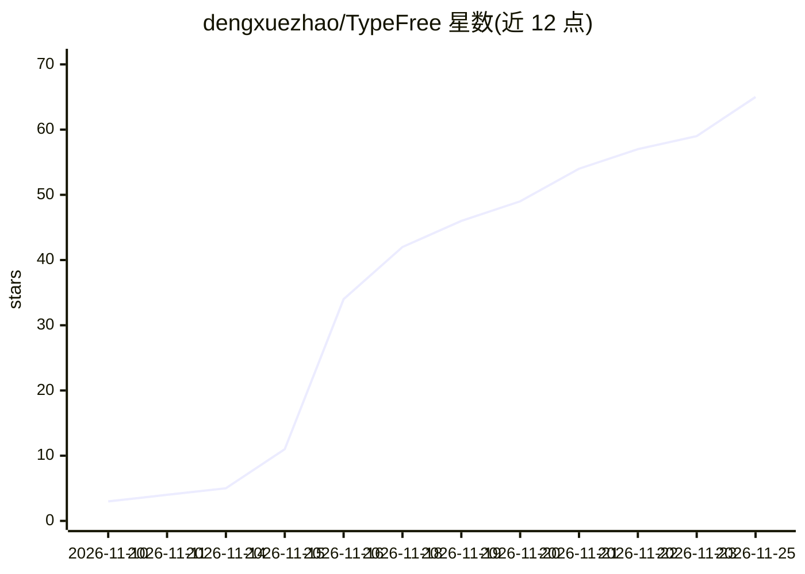

# dengxuezhao/TypeFree

⭐ 65 · Kotlin · GPL-3.0 · 推送 2026-11-23 · [GitHub](https://github.com/dengxuezhao/TypeFree) · 个人维护 · 中文 README

**Android 原生 AI 语音输入法与全局悬浮胶囊（BYOK 多引擎）**

纯 Kotlin + Jetpack Compose + Material 3 构建的开源 Android 输入法：语音识别与 AI 润色/帮写/改写/快译组成两阶段管线，凭证由用户自带（Google Gemini、阿里云百炼、火山豆包、硅基流动、DeepSeek、Groq 或自定义 OpenAI 兼容网关），支持本地 whisper.cpp + Ollama 全离线组合。另集成原生 librime 1.17.0 引擎与雾凇拼音等三种方案、智能剪贴板实体提取与大爆炸拆词、端侧隐私脱敏与读屏多模态帮回（Android 11+ 无障碍截屏）。要求 Android 8.0+，提供预编译 APK，也可源码编译。

## 筛选速览

| 维度 | 判定 | 备注 |
|---|---|---|
| AI 角色 | `ai-native` | 本体是模型或模型工具 |
| 许可风险 | `viral` | GPL-3.0 |
| 部署形态 | `None` |  |
| 模型依赖 | local-ok | 支持本地模型 |
| 硬件要求 | — | 无带数字的原话,不猜 |
| 安装摩擦 | `medium` | 含编译或系统依赖之一 |
| 成熟度 | — | 结构信号不足 |

## 能力要点

- 两阶段管线：流式 ASR 识别 + LLM 润色，流式边说边上屏
- BYOK 多服务商凭证保险箱，支持局域网 whisper.cpp + Ollama 全离线
- 原生 librime 1.17.0（arm64-v8a）集成雾凇拼音/小鹤双拼/小鹤音形
- 端侧敏感信息正则脱敏、读屏截屏用完即焚零落盘

## 适用场景

- 用语音在任意 App 输入并自动去口癖润色
- 微信/QQ 等聊天场景按屏幕上下文让 AI 起草回复
- 自带 API Key 或局域网本地模型，替代订阅制语音输入服务
- 在手机上使用雾凇拼音等 Rime 方案打字

## 场景标签

`语音识别` `AI 写作` · 领域:内容生成

## 证据(README 行号)

> L5:  受现代极简声波美学启发，纯原生 Kotlin + Jetpack Compose + Material 3 构建的开源 Android AI 语音键盘与全局悬浮胶囊。
> L6:  全面践行 BYOK (Bring Your Own Key) 与私有化部署理念，零订阅门槛、零第三方隐私采集，让自然语音输入与智能改写回归纯粹自由。
> L94:  - **第 1 层 · 服务商凭证保险箱 (`Provider Vault`)**：点击对应厂商（Google Gemini、阿里云百炼、火山引擎、硅基流动、DeepSeek 或自定义 OpenAI 兼容网关），填入 API K

## 星数曲线

2026-11-10 3 → 2026-11-25 65（+62）

---
*卡片 v1 · prompt 1.4 · 生成 2026-11-18 · 置信度 high · 依据 README sha `1bc38067ccc4` · [字段定义](../../DATASET.md)*
