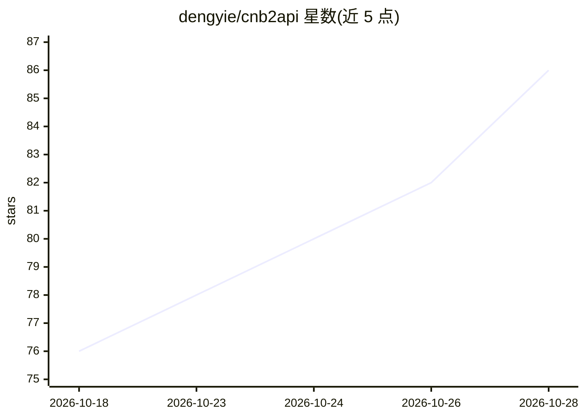

# dengyie/cnb2api

⭐ 86 · JavaScript · MIT · 推送 2026-10-04 · [GitHub](https://github.com/dengyie/cnb2api) · [官网](https://github.com/dengyie/cnb2api#readme) · 个人维护 · 中文 README

**把 CNB 云工作区内网 AI 转成 OpenAI/Anthropic 兼容 API 网关**

运行在 CNB 云工作区内的代理网关：将仅限工作区内网访问的 AI 补全端点转换为公网可访问的 OpenAI（/v1/chat/completions）与 Anthropic（/v1/messages）双协议 API，支持 SSE 流式、工具调用透传及 Claude Code CLI 直连。零 npm 依赖，全部基于 Node.js 22+ 内建原语；v5.2 架构通过 cron 管道、动态子域名自动注册与外部 watchdog 实现自愈高可用。附带 cnb2api-quota 终端 CLI 查询配额。限制：依赖 CNB 平台的配额与网络策略，需配置 PROXY_KEY 与 CNB_TOKEN。

## 筛选速览

| 维度 | 判定 | 备注 |
|---|---|---|
| AI 角色 | `ai-ecosystem` | LLM/agent 周边工具 |
| 许可风险 | `permissive` | MIT |
| 部署形态 | `library` | 以包/库形式分发 |
| 模型依赖 | — | README 未给出锁定关系 |
| 硬件要求 | — | 无带数字的原话,不猜 |
| 安装摩擦 | `low` | 无编译、无系统依赖或容器化 |
| 成熟度 | — | 结构信号不足 |

## 能力要点

- OpenAI + Anthropic 双协议端点，SSE 流式与工具调用透传
- v5.2 双看门狗自愈：cron 恢复 + 动态子域名注册 + 外部 watchdog，恢复约 2 分 13 秒
- 零 npm 依赖，Node.js 22+ 内建原语构建
- cnb2api-quota CLI 终端仪表盘与 /usage 用量统计

## 适用场景

- 把 CNB 工作区的免费 DeepSeek 配额接入 Claude Code、Cursor 等 AI 工具
- 为 OpenAI 兼容客户端（LobeChat、Open WebUI 等）提供统一 API 网关
- 在终端随时查看 AI 配额剩余与消耗情况

## 场景标签

`模型网关` · 领域:Agent 开发

## 证据(README 行号)

> L3: **Turn CNB Cloud Workspace In-Network AI into a Production-Ready API Gateway**
> L41:  - **OpenAI Compatible**: `/v1/chat/completions` and `/v1/models`, supporting SSE streaming and faithful non-stream
> L42:  - **Anthropic Compatible**: `/v1/messages` and `/v1/messages/count_tokens`, enabling **Claude Code CLI direct conn

## 星数曲线

2026-10-18 76 → 2026-10-28 86（+10）

---
*卡片 v1 · prompt 1.4 · 生成 2026-10-24 · 置信度 high · 依据 README sha `996ea0358c1c` · [字段定义](../../DATASET.md)*
