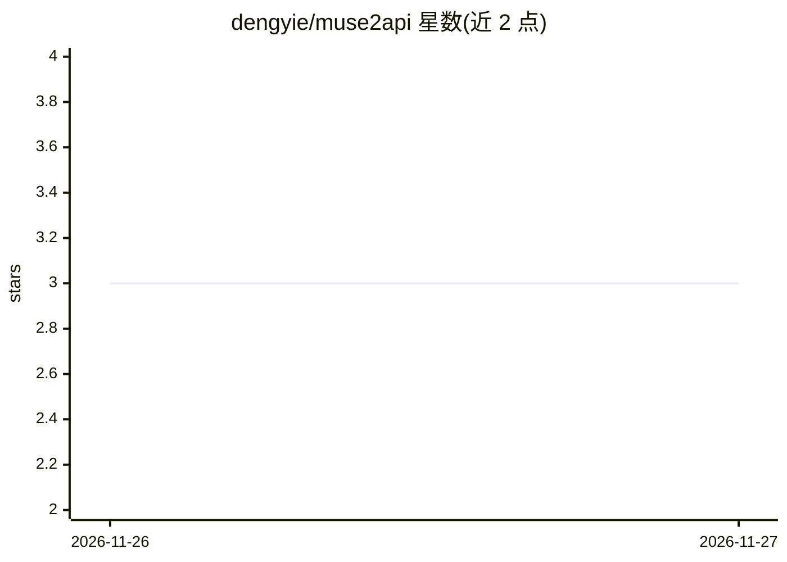

# dengyie/muse2api

⭐ 3 · Python · MIT · 推送 2026-11-26 · [GitHub](https://github.com/dengyie/muse2api) · 个人维护 · 中文 README

**把 muse.ai 网页端封装为 OpenAI 兼容 API 的反向代理网关**

通过无头浏览器 CDP 协议、WebSocket 隧道复用与动态 Session 管理，将 muse.ai 网页端的多模态能力封装为 OpenAI 兼容 RESTful API，提供文本对话、文生图、图生图、文生视频与首帧图生视频接口。内置多账号池亲和轮转、每账号独立浏览器指纹与出口代理、48 小时会话自动续期、幂等重放保护、stage 流水线可观测与媒体云备份。本仓库为上游 czg86389-hub/muse2api 的生产增强 fork，部署依赖 Chromium 与 FFmpeg，账号登录态经配套 Chrome 扩展或油猴脚本导入。

## 筛选速览

| 维度 | 判定 | 备注 |
|---|---|---|
| AI 角色 | `ai-native` | 本体是模型或模型工具 |
| 许可风险 | `permissive` | MIT |
| 部署形态 | `self-host` | docker 或自建部署 |
| 模型依赖 | — | README 未给出锁定关系 |
| 硬件要求 | — | 无带数字的原话,不猜 |
| 安装摩擦 | `low` | 无编译、无系统依赖或容器化 |
| 成熟度 | — | 结构信号不足 |

## 能力要点

- 兼容 /v1/chat/completions、/v1/images/generations、/v1/videos 等 OpenAI 协议接口
- TetherPool/IP-Pool 出口池集成与每账号独立指纹隔离
- 多账号池亲和轮转、故障转移与全自动会话续期保活
- 配套 Chrome 一键导号扩展与 Web 运维面板

## 适用场景

- 以 OpenAI 兼容接口调用 muse.ai 的对话、生图与视频生成能力
- 多账号池化调度并按账号绑定独立代理出口
- 长期运行的媒体生成服务需要幂等保护与云备份

## 场景标签

`图像生成` `视频生成` · 领域:内容生成

## 证据(README 行号)

> L9: 将 **muse.ai** 网页端的前沿多模态能力逆向工程封装为标准的 **OpenAI 兼容 RESTful API**。通过无头浏览器 CDP 协议穿透、热备 WebSocket 隧道复用与动态 Session 管理，原生支持文
> L55: - 💬 **标准对话接口（Chat Completions & Responses API）**
> L66:  - 原生对接 Muse 顶配视频生成模型，可传递 5 秒 / 6 秒 / 8 秒 / 10 秒的时长请求（实际成片时长以 Muse 上游输出为准）及 `9:16` 竖屏 / `16:9` 横屏视频生成。

## 星数曲线

2026-11-26 3 → 2026-11-27 3（+0）

---
*卡片 v1 · prompt 1.4 · 生成 2026-11-26 · 置信度 high · 依据 README sha `c17a41588884` · [字段定义](../../DATASET.md)*
