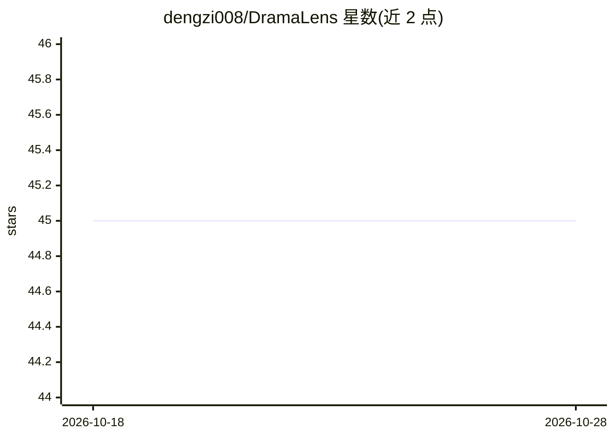

# dengzi008/DramaLens

⭐ 45 · JavaScript · AGPL-3.0 · 推送 2026-08-24 · [GitHub](https://github.com/dengzi008/DramaLens) · 个人维护 · 中文 README

**本地优先 Chrome 扩展：短剧音频转写与人工复核的创作拆解**

由本地 Python 服务与 Chrome 扩展组成：主动捕获标签页或桌面音频（Windows WASAPI Loopback / macOS BlackHole），用本地 faster-whisper 生成带时间码的中文转写，在扩展中人工修改文本与角色，再经用户自配置的 OpenAI 兼容接口生成剧情梗概、冲突节点、情绪曲线等创作结构分析，可导出 Word 报告。原始音频仅发到本机 127.0.0.1，转写无需 API 密钥。角色推断由语言模型完成，输出需人工复核；项目无 Chrome Web Store 正式版本，需开发者模式加载。

## 筛选速览

| 维度 | 判定 | 备注 |
|---|---|---|
| AI 角色 | `ai-native` | 本体是模型或模型工具 |
| 许可风险 | `viral` | AGPL-3.0 |
| 部署形态 | `None` |  |
| 模型依赖 | — | README 未给出锁定关系 |
| 硬件要求 | — | 无带数字的原话,不猜 |
| 安装摩擦 | `low` | 无编译、无系统依赖或容器化 |
| 成熟度 | `idea` | |

## 能力要点

- 标签页/桌面音频采集 + 本地 faster-whisper 时间码转写
- OpenAI 兼容接口生成剧情结构分析（冲突、钩子、反转等）
- 单集复核、多集整体分析与 Word 报告导出
- 本地优先：音频仅发本机，AI 接口用户自配置

## 适用场景

- 研究短剧节奏、冲突与人物关系时自动整理台词与时间码
- 对授权访谈或视听素材做带时间码的转写与结构分析
- 批量整理多集素材并生成创作拆解报告

## 场景标签

`语音识别` · 领域:感知与多模态

## 证据(README 行号)

> L13: - 使用本地 `faster-whisper` 生成中文时间轴
> L15: - 通过 OpenAI 兼容文本接口生成单集创作拆解

## 星数曲线

2026-10-18 45 → 2026-10-28 45（+0）

---
*卡片 v1 · prompt 1.4 · 生成 2026-10-25 · 置信度 high · 依据 README sha `55ce8cc9688a` · [字段定义](../../DATASET.md)*
