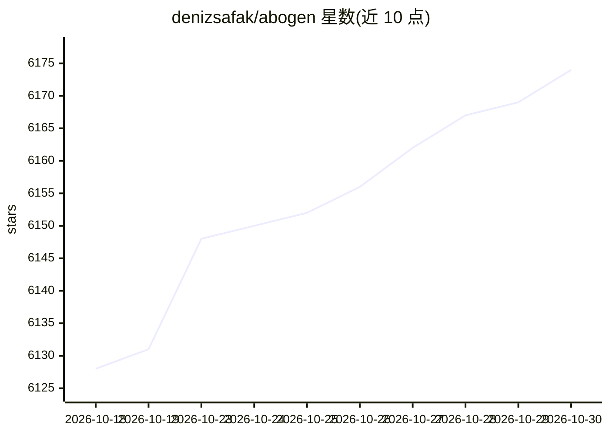

# denizsafak/abogen

⭐ 6,174 · Python · MIT · 推送 2026-10-25 · [GitHub](https://github.com/denizsafak/abogen) · [官网](https://pypi.org/project/abogen/) · 个人维护

**把 EPUB/PDF/文本转成带同步字幕的有声书工具**

基于 Kokoro-82M 的文本转语音应用，读取 ePub、PDF、文本、markdown 及字幕文件（SRT/ASS/VTT），生成音频与时间同步的字幕，支持语速调节、声音混合自定义、章节拆分/合并、队列批处理，输出 WAV/FLAC/MP3/OPUS/M4B 等格式。提供两种界面：PyQt6 桌面 GUI（abogen）与功能更多的 Flask Web UI（abogen-web，含 Supertonic TTS、LLM Normalization、Audiobookshelf 集成）。通过 PyPI/uv/pip 或 Windows 安装脚本安装，espeak-ng 为必备系统依赖，可完全离线运行。

## 筛选速览

| 维度 | 判定 | 备注 |
|---|---|---|
| AI 角色 | `ai-native` | 本体是模型或模型工具 |
| 许可风险 | `permissive` | MIT |
| 部署形态 | `desktop` | 安装包/桌面程序 |
| 模型依赖 | — | README 未给出锁定关系 |
| 硬件要求 | — | 无带数字的原话,不猜 |
| 安装摩擦 | `low` | 无编译、无系统依赖或容器化 |
| 成熟度 | — | 结构信号不足 |

## 能力要点

- Kokoro-82M 引擎生成音频并输出同步字幕（SRT/ASS 多种样式）
- 支持 ePub/PDF/markdown/字幕文件输入，章节选择、分章保存与合并
- 声音混合器可混合多声音模型创建自定义声音并保存配置
- 桌面 GUI 与 Web UI 双界面，Web UI 含 LLM 文本规范化与 Audiobookshelf 集成
- 可预下载模型与声音实现完全离线使用

## 适用场景

- 把电子书或文档转成带同步字幕的有声书
- 为短视频等创作项目批量生成配音与字幕
- 将字幕文件重新配音并调整语速对齐时间轴

## 场景标签

`语音合成` · 领域:内容生成

## 证据(README 行号)

> L13: Abogen is a powerful text-to-speech conversion tool that makes it easy to turn ePub, PDF, text, markdown, or subtit
> L112: |`abogen-web`|Flask Web UI|Core features + **Supertonic TTS**, **LLM Normalization**, **Audiobookshelf Integration

## 星数曲线

2026-10-18 6,128 → 2026-10-30 6,174（+46）

---
*卡片 v1 · prompt 1.4 · 生成 2026-10-20 · 置信度 high · 依据 README sha `46f7cba86d33` · [字段定义](../../DATASET.md)*
