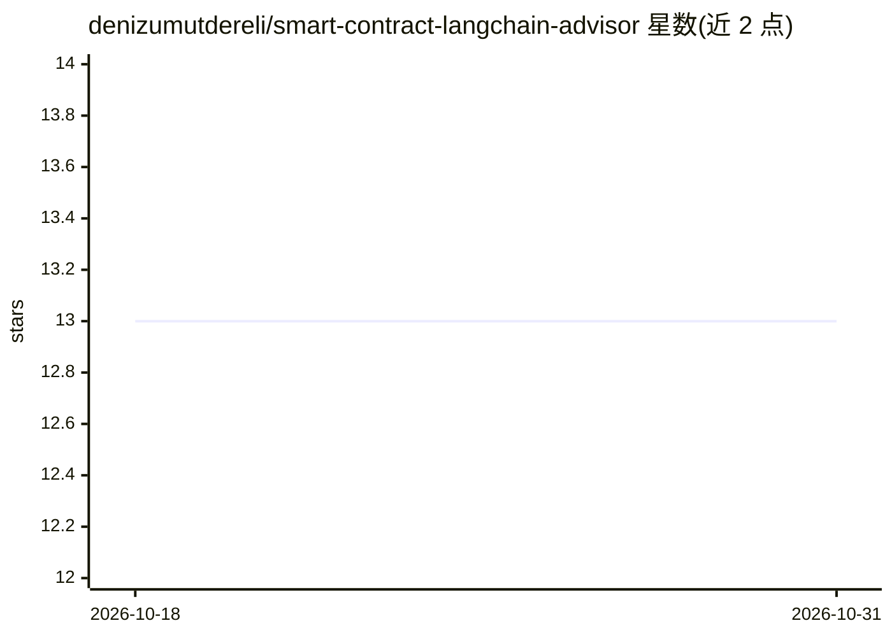

# denizumutdereli/smart-contract-langchain-advisor

⭐ 13 · Python · 推送 2026-03-18 · [GitHub](https://github.com/denizumutdereli/smart-contract-langchain-advisor) · 个人维护

**面向 Solidity 开发者的智能合约问答顾问（RAG + GPT-4）**

面向 Solidity 开发者与学习者的问答应用：从 Etherscan 下载 5,000 个已验证智能合约并抓取 Solidity 官方 HTML 文档，经 Solidity 专用解析器与文本切分后生成约 20 万个嵌入块（大小 1000、重叠 1000），存入 Weaviate 向量库（text2vec-contextionary 模块）；Flask API 通过 LangChain RetrievalQA 检索并调用 OpenAI GPT-4-0613 生成回答，ReactJS/TypeScript 提供 ChatGPT 式界面。安装需 Docker Compose 启动 MongoDB/Weaviate，并配置 OpenAI、Etherscan 密钥，backend 与 client 分别以 npm 启动；需要 OpenAI API key 为限制。

## 筛选速览

| 维度 | 判定 | 备注 |
|---|---|---|
| AI 角色 | `ai-native` | 本体是模型或模型工具 |
| 许可风险 | `none` | — |
| 部署形态 | `self-host` | docker 或自建部署 |
| 模型依赖 | — | README 未给出锁定关系 |
| 硬件要求 | — | 无带数字的原话,不猜 |
| 安装摩擦 | `low` | 无编译、无系统依赖或容器化 |
| 成熟度 | — | 结构信号不足 |

## 能力要点

- 5,000 个 Etherscan 已验证合约 + Solidity 官方文档构成知识库，约 20 万嵌入块
- LangChain RetrievalQA + Weaviate（text2vec-contextionary）语义检索
- Flask API 调用 GPT-4-0613 生成回答，控制台显示引用的向量来源
- ChatGPT 式 ReactJS/TypeScript 前端，含对话历史

## 适用场景

- 询问 Solidity 概念（如重入攻击）并获得基于已验证代码的回答
- 提交自己的合约代码获取分析建议
- 查阅回答所引用的合约或官方文档片段

## 场景标签

`文档问答` · 领域:知识与检索

## 证据(README 行号)

> L6: The Solidity Smart-Contract Advisor is a cutting-edge tool designed to extend the capabilities of traditional langua
> L66: This Python-based Flask API serves as a crucial bridge between user queries and the powerful backend. It efficientl
> L93: To interact with the Smart-Contract Advisor, users can input their queries through the UI. The system is designed t

## 星数曲线

2026-10-18 13 → 2026-10-31 13（+0）

---
*卡片 v1 · prompt 1.4 · 生成 2026-10-31 · 置信度 high · 依据 README sha `23c3b1cc5378` · [字段定义](../../DATASET.md)*
