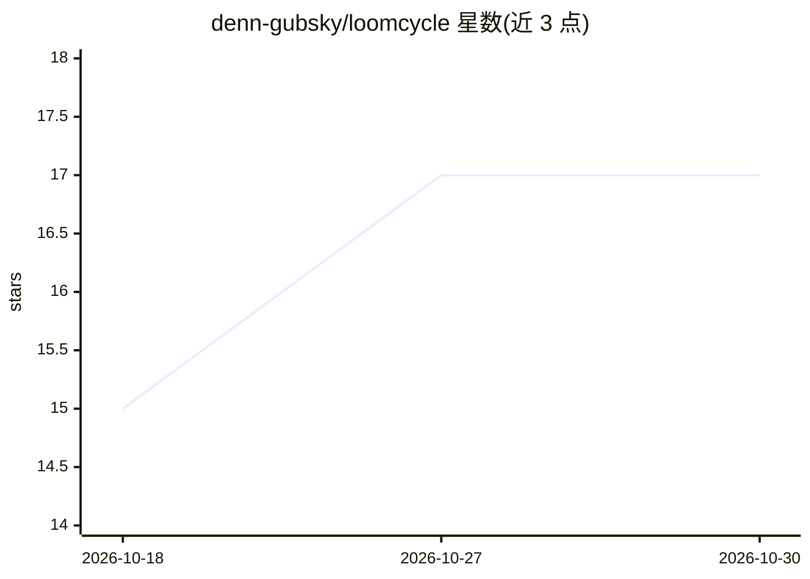

# denn-gubsky/loomcycle

⭐ 17 · Go · Apache-2.0 · 推送 2026-10-29 · [GitHub](https://github.com/denn-gubsky/loomcycle) · [官网](https://loomcycle.dev) · 个人维护

**自托管的 agent 系统内核：单 Go 二进制运行多 agent 循环**

以单个约 80 MB Go 二进制交付的自托管 agent 运行时：内置 agent 循环、agentic 记忆（含向量/SQL/双时态实体图）、文档存储、Teams 状态机多 agent 工作流、Decision 与 Crypto 工具、临时 git 卷、LoomBoard 可视化画布、捆绑开发工具链与 headless Chromium，支持 Postgres 上多副本 HA。接入 Anthropic/OpenAI/DeepSeek/Gemini/Ollama 六类 provider，经 HTTP/gRPC/MCP/TS/Python 适配器被应用调用。面向自建 agent 基础设施的开发者/团队，Apache-2.0。

## 筛选速览

| 维度 | 判定 | 备注 |
|---|---|---|
| AI 角色 | `ai-ecosystem` | LLM/agent 周边工具 |
| 许可风险 | `permissive` | Apache-2.0 |
| 部署形态 | `desktop` | 安装包/桌面程序 |
| 模型依赖 | local-ok | 支持本地模型 |
| 硬件要求 | — | 无带数字的原话,不猜 |
| 安装摩擦 | `low` | 无编译、无系统依赖或容器化 |
| 成熟度 | — | 结构信号不足 |

## 能力要点

- 单二进制内置 agent 循环、记忆、文档、工具链与 headless Chromium
- Anthropic/OpenAI/DeepSeek/Gemini/Ollama 经统一 Provider 接口接入（无厂商 SDK）
- Crypto 工具密钥对模型不可见，可存于 Vault/AWS KMS/Google Cloud KMS
- Postgres 多副本 HA 与 OpenTelemetry

## 适用场景

- 自托管运行多 agent 工作流并管理其记忆与文档
- 让应用经 HTTP/gRPC/MCP/适配器调用 agent 循环
- 以状态机 Team 编排多 agent 并在可视化画布调试

## 场景标签

`多智能体` `Agent 框架` `Agent 记忆` · 领域:Agent 开发

## 证据(README 行号)

> L3:  An agent-system kernel you self-host.
> L19: **An agent-system kernel you self-host.** loomcycle is one Go binary, ~80 MB. It owns the agent loop and ships with
> L45: |**Providers**|Anthropic, OpenAI, DeepSeek, Gemini, Ollama (cloud + local) over native HTTP with no vendor SDK, beh

## 星数曲线

2026-10-18 15 → 2026-10-30 17（+2）

---
*卡片 v1 · prompt 1.4 · 生成 2026-10-29 · 置信度 mid · 依据 README sha `53f5b6d66235` · [字段定义](../../DATASET.md)*
