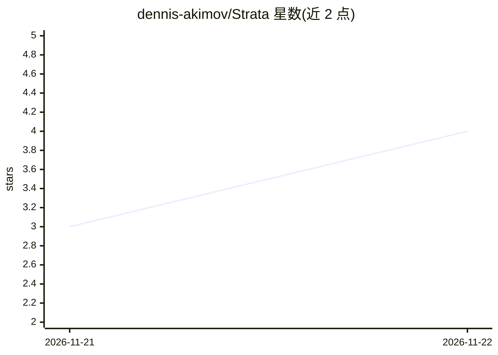

# dennis-akimov/Strata

⭐ — · [GitHub]() · 个人维护 · 中文 README

**在 Mac 上本地运行 100B 级大模型的推理引擎与应用**

面向 Apple Silicon Mac 的本地大模型运行时：通过基于 llama.cpp/ggml 的 Metal 引擎在本地运行 GPT-OSS 120B、Qwen3.8-Flash-Next、GLM-5.3-Flash 等大参数模型，并在 localhost 提供 OpenAI/Anthropic/Responses API，可接入编程 agent 与 MCP 服务器；同时支持文本生成图像（HunyuanImage-3.0、Nucleus-Image）与视频（Wan 2.2）。README 大量给出各模型在不同 Mac 与内存配置下的 tokens/s、内存占用与多 agent 并发（1-4 agents、上下文池、路由）实测表。本仓库为 fork，仅维护 Mac 引擎，原 Windows/Linux（CUDA/HIP/SYCL）引擎不再构建更新；16 GB Mac 需调高系统 GPU 内存上限。

## 筛选速览

| 维度 | 判定 | 备注 |
|---|---|---|
| AI 角色 | `ai-ecosystem` | LLM/agent 周边工具 |
| 许可风险 | `permissive` | — |
| 部署形态 | `self-host` | docker 或自建部署 |
| 模型依赖 | — | README 未给出锁定关系 |
| 硬件要求 | `gpu-8g` | |
| 安装摩擦 | `low` | 无编译、无系统依赖或容器化 |
| 成熟度 | — | 结构信号不足 |

## 能力要点

- Metal 引擎在 Apple Silicon 上运行 GPT-OSS 120B 等大模型，实测 tokens/s 与内存数据齐备
- localhost 提供 OpenAI/Anthropic/Responses API，可接入编程 agent 与 MCP
- 多 agent 并发：单份权重单端口支持 1-8 个并行 agent、对话缓存、共享上下文池与跨机路由
- 文本生成图像（HunyuanImage-3.0/Nucleus-Image）与视频（Wan 2.2），web chat 支持 /image 与 /video

## 适用场景

- 在 Mac 本地运行大参数模型供编程 agent 调用
- 本地并行跑多个 AI agent 并管理上下文与缓存
- 本地生成图片和短视频

## 场景标签

`推理引擎` `图像生成` `视频生成` · 领域:内容生成

## 证据(README 行号)

> L8: > **This is an independently maintained fork of Strata for Apple Silicon Macs
> L16: Strata runs large AI models on your own computer: they chat, write code, read pictures and work with your apps and
> L43: **Several agents at once.** One model can answer several requests at the same time: `"parallel": N` in the run conf

## 星数曲线

2026-11-21 3 → 2026-11-22 4（+1）

---
*卡片 v1 · prompt 1.4 · 生成 2026-11-22 · 置信度 mid · 依据 README sha `f263176001db` · [字段定义](../../DATASET.md)*
