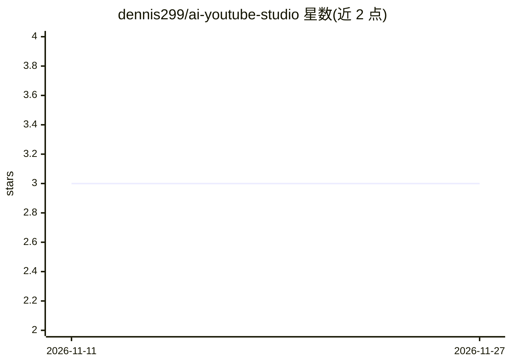

# dennis299/ai-youtube-studio

⭐ 3 · TypeScript · MIT · 推送 2026-10-31 · [GitHub](https://github.com/dennis299/ai-youtube-studio) · 个人维护

**让个人创作者用 AI 端到端运营无人出镜 YouTube 频道**

本地运行的 Next.js 应用，把无人出镜频道的整条流水线集中到一个界面：选定位、拉取 YouTube 数据做选题研究、生成频道包装、月度 20 条视频计划、分镜脚本、每周人工审批关卡，随后经 OpenMontage 生成正片与 9:16 Short，并统计数据回流下月计划。AI 大脑两种模式：Agent 模式复用已有的编码代理（无需 API key），或粘贴 OpenAI/Anthropic key 走 API 模式；两种模式共享提示词与 zod 校验。仓库附带一个真实示例频道。

## 筛选速览

| 维度 | 判定 | 备注 |
|---|---|---|
| AI 角色 | `ai-native` | 本体是模型或模型工具 |
| 许可风险 | `permissive` | MIT |
| 部署形态 | `library` | 以包/库形式分发 |
| 模型依赖 | — | README 未给出锁定关系 |
| 硬件要求 | — | 无带数字的原话,不猜 |
| 安装摩擦 | `medium` | 含编译或系统依赖之一 |
| 成熟度 | — | 结构信号不足 |

## 能力要点

- Agent 模式无需 API key，任意能读写文件的编码代理均可处理待办任务
- 唯一人工关卡：周检入审批与分镜哈希绑定，编辑即失效
- 研究/计划/分镜/洞察均为类型化 AI 任务，输出经 zod 校验
- 未通过 YouTube 审计时生成手动上传套件，含 AI 披露标记

## 适用场景

- 每周批量规划并产出 5 条无人出镜视频
- 用公开数据研究高表现选题并生成内容支柱
- YouTube 数据 API 配额内拉取统计并让 AI 归纳成败原因

## 场景标签

`视频生成` · 领域:内容生成

## 证据(README 行号)

> L25: - 🧠 **Bring your own brain.** Use a coding agent (Claude Code, Codex, Cursor, …) with no API key, or plug in an Ope
> L55: |2. Research|**Research**|Pulls the top-performing long-form videos for your searches from the YouTube Data API (vi
> L84: - **Agent mode** writes a markdown brief per job (with the exact JSON schema) to `jobs/pending/`.

## 星数曲线

2026-11-11 3 → 2026-11-27 3（+0）

---
*卡片 v1 · prompt 1.4 · 生成 2026-11-22 · 置信度 high · 依据 README sha `ceccd041e328` · [字段定义](../../DATASET.md)*
