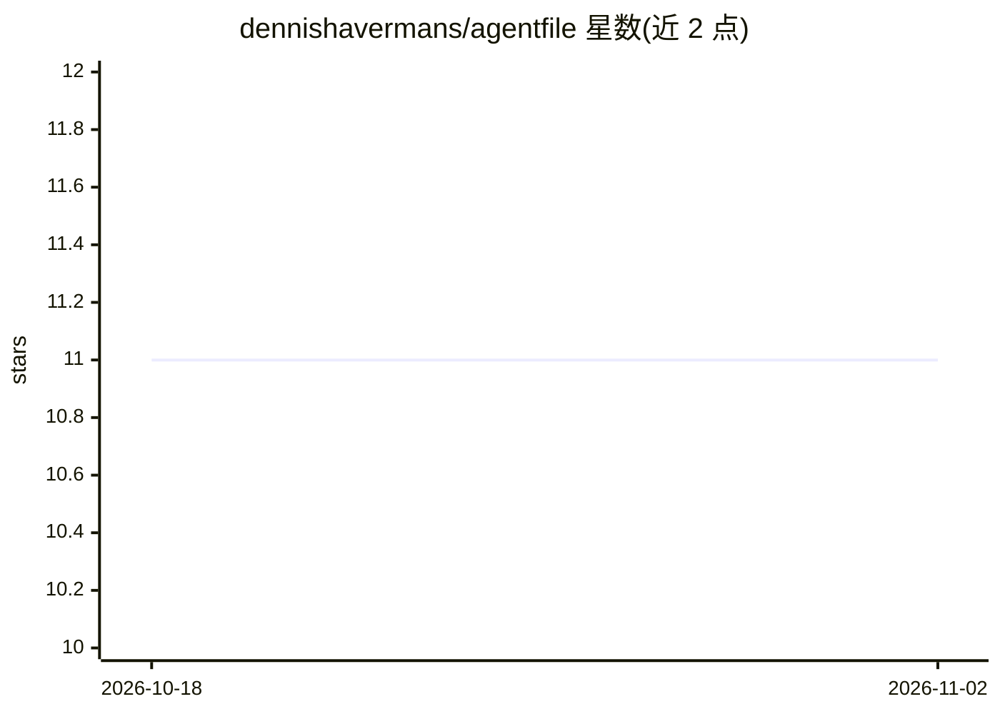

# dennishavermans/agentfile

⭐ 11 · TypeScript · MIT · 推送 2026-11-01 · [GitHub](https://github.com/dennishavermans/agentfile) · [官网](https://www.npmjs.com/package/@agentfile/cli) · 个人维护

**CLI 工具：检测仓库中 AI agent 配置的漂移与风险**

面向使用多种 AI 编码工具（Claude Code、Copilot、Cursor、Codex）的团队，agentfile 以 npm CLI 形式读取仓库中既有的 AGENTS.md、CLAUDE.md、.cursor/rules、.mcp.json 等配置文件，归一化为单一模型后做诊断：跨平台规则漂移、上下文 token 成本估算、MCP 服务器静默失败、hooks 与权限规则过宽等安全审计。全部流程确定性执行，无模型调用、无网络请求、不执行任何被发现的脚本。提供 doctor/adopt/compile/validate/lint/audit 等命令，可接入 pre-commit 与 CI。

## 筛选速览

| 维度 | 判定 | 备注 |
|---|---|---|
| AI 角色 | `ai-ecosystem` | LLM/agent 周边工具 |
| 许可风险 | `permissive` | MIT |
| 部署形态 | `library` | 以包/库形式分发 |
| 模型依赖 | — | README 未给出锁定关系 |
| 硬件要求 | — | 无带数字的原话,不猜 |
| 安装摩擦 | `low` | 无编译、无系统依赖或容器化 |
| 成熟度 | — | 结构信号不足 |

## 能力要点

- doctor 一条命令扫描多平台 agent 配置并输出稳定诊断码
- audit 对 hooks/skills/MCP/权限规则做静态安全分析，不执行任何发现物
- adopt/compile 支持以 AGENTS.md 为单一来源生成其他平台文件
- check 全量运行约 140ms，适配 pre-commit 与 CI

## 适用场景

- 团队同时用多个 AI 编码工具时排查配置互相矛盾
- 控制每会话加载的上下文 token 成本
- 在 CI 中严格校验 agent 配置与 SKILL.md 规范
- 审计 hooks 和 MCP 服务器是否授予超出预期的权限

## 场景标签

`网络安全` · 领域:学习与行业

## 证据(README 行号)

> L35: npx @agentfile/cli audit               # what a hook, skill or MCP server could do
> L229: ### `npx @agentfile/cli audit`

## 星数曲线

2026-10-18 11 → 2026-11-02 11（+0）

---
*卡片 v1 · prompt 1.4 · 生成 2026-11-02 · 置信度 high · 依据 README sha `d78bf2f06a18` · [字段定义](../../DATASET.md)*
