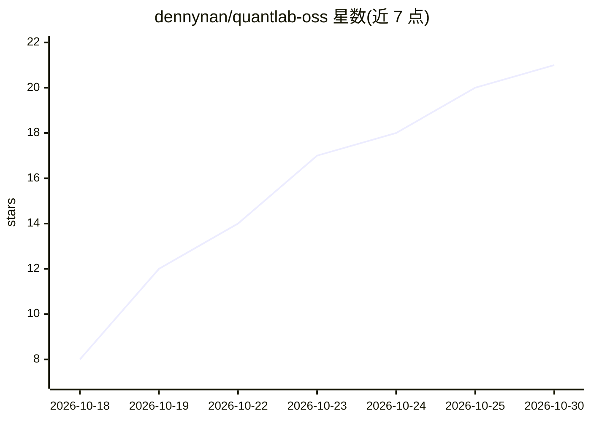

# dennynan/quantlab-oss

⭐ 21 · Python · MIT · 推送 2026-10-13 · [GitHub](https://github.com/dennynan/quantlab-oss) · [官网](https://dennynanmac-mini.tail1971a3.ts.net:8444) · 个人维护 · 中文 README

**AI 驱动的开源量化分析平台：因子分析/选股/回测/因子挖掘**

基于 Qlib + Alpha158 + FastAPI + Vue3 的量化分析 Web 平台：提供因子计算与选股、多因子排名 TopK 轮动回测（含涨跌停/T+1/成本约束、任务落盘与按访客隔离）、LightGBM 等模型训练评估，可选集成微软 RD-Agent 做自动因子挖掘（本仓库附带针对上游 v1.0.0 的挖因子升级补丁）。默认附带可复现的合成样例数据（40 只 × 300 日），可用纯标准库脚本从公开接口拉取近 1 年真实行情。免登录、供学习研究用途，声明不构成投资建议。

## 筛选速览

| 维度 | 判定 | 备注 |
|---|---|---|
| AI 角色 | `ai-native` | 本体是模型或模型工具 |
| 许可风险 | `permissive` | MIT |
| 部署形态 | `library` | 以包/库形式分发 |
| 模型依赖 | — | README 未给出锁定关系 |
| 硬件要求 | — | 无带数字的原话,不猜 |
| 安装摩擦 | `low` | 无编译、无系统依赖或容器化 |
| 成熟度 | — | 结构信号不足 |

## 能力要点

- Alpha158 多因子排名选股 + TopK 定期轮动回测，含涨跌停/T+1/成本模型约束
- 模型实验室：LightGBM 等模型训练与评估
- 可选集成 RD-Agent 自动因子挖掘，附带入库前重选/相关性剪枝/正交化等升级补丁
- 纯标准库行情拉取脚本（东方财富主源、腾讯回退），无需 token

## 适用场景

- 用 Alpha158 因子做选股与轮动回测实验
- 训练和评估量化模型并对比表现
- 跑通 RD-Agent 自动因子挖掘流程并管理任务记录

## 场景标签

`金融量化` `模型训练` · 领域:学习与行业

## 证据(README 行号)

> L3: > 🧪 一个 AI 驱动的量化分析平台 —— 因子分析、选股、回测、模型实验与自动因子挖掘。
> L16: - **因子分析 / 选股**：基于 Qlib + Alpha158 的因子计算与股票筛选
> L19: - **自动因子挖掘**：集成 RD-Agent（可选），一键发起因子挖掘任务

## 星数曲线

2026-10-18 8 → 2026-10-30 21（+13）

---
*卡片 v1 · prompt 1.4 · 生成 2026-10-28 · 置信度 mid · 依据 README sha `4fa0281fc071` · [字段定义](../../DATASET.md)*
