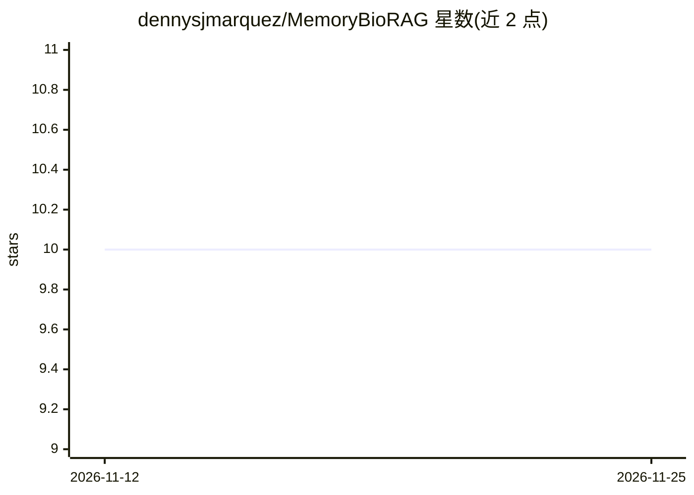

# dennysjmarquez/MemoryBioRAG

⭐ 10 · Python · Apache-2.0 · 推送 2026-11-23 · [GitHub](https://github.com/dennysjmarquez/MemoryBioRAG) · [官网](https://dennysjmarquez.dev/) · 个人维护

**为 AI 代理提供跨会话持久符号记忆的检索引擎**

面向 AI 代理的持久化符号记忆系统：以 Python + SQLite FTS5 为核心，通过 BM25、PPMI-SVD（100 维）、13 轴语义空间、赫布突触图、SDM（2048 位）、ACT-R 激活与 Concept Hubs 组成混合检索路径，检索路径不调用外部 API、不使用稠密嵌入与 GPU。支持西/英双语检索（双语词干化、WordNet 符号扩展），学习到的重排神经元随各数据库本地保存。要求 Python >=3.11，内存库默认位于 ~/.biorag/，提供 MCP 配置安装器与可选守护进程（默认关闭）。README 注明 v36.0 尚未合入 master、未打 tag。

## 筛选速览

| 维度 | 判定 | 备注 |
|---|---|---|
| AI 角色 | `ai-ecosystem` | LLM/agent 周边工具 |
| 许可风险 | `permissive` | Apache-2.0 |
| 部署形态 | `None` |  |
| 模型依赖 | — | README 未给出锁定关系 |
| 硬件要求 | — | 无带数字的原话,不猜 |
| 安装摩擦 | `low` | 无编译、无系统依赖或容器化 |
| 成熟度 | — | 结构信号不足 |

## 能力要点

- PPMI-SVD + FTS5 BM25 + 突触图 + Concept Hubs 的混合检索，检索路径无外部 API 调用
- 西班牙语与英语双语检索（双语 stemming 与 WordNet 扩展）
- 随数据库本地学习的重排神经元，可通过 --con-neurona 参数评估
- 提供 MCP 配置安装器，生成的配置使用 stdio 传输

## 适用场景

- 为代理在会话之间保留与检索长期记忆
- 在无 GPU、无外部 API 的本地环境运行语义检索
- 西英双语语料的记忆召回与排序

## 场景标签

`Agent 记忆` `语义搜索` `知识图谱` · 领域:Agent 开发

## 证据(README 行号)

> L4: > **Paradigma:** Motor Python + SQLite FTS5. **Sin embeddings densos, GPU ni llamadas a APIs externas** en el path d
> L5: > **Motor:** Arquitectura modularizada (18 submódulos `core/memory/` + 15 submódulos `core/mcp_server/` + fachada de

## 星数曲线

2026-11-12 10 → 2026-11-25 10（+0）

---
*卡片 v1 · prompt 1.4 · 生成 2026-11-19 · 置信度 mid · 依据 README sha `ccb0f460b10f` · [字段定义](../../DATASET.md)*
