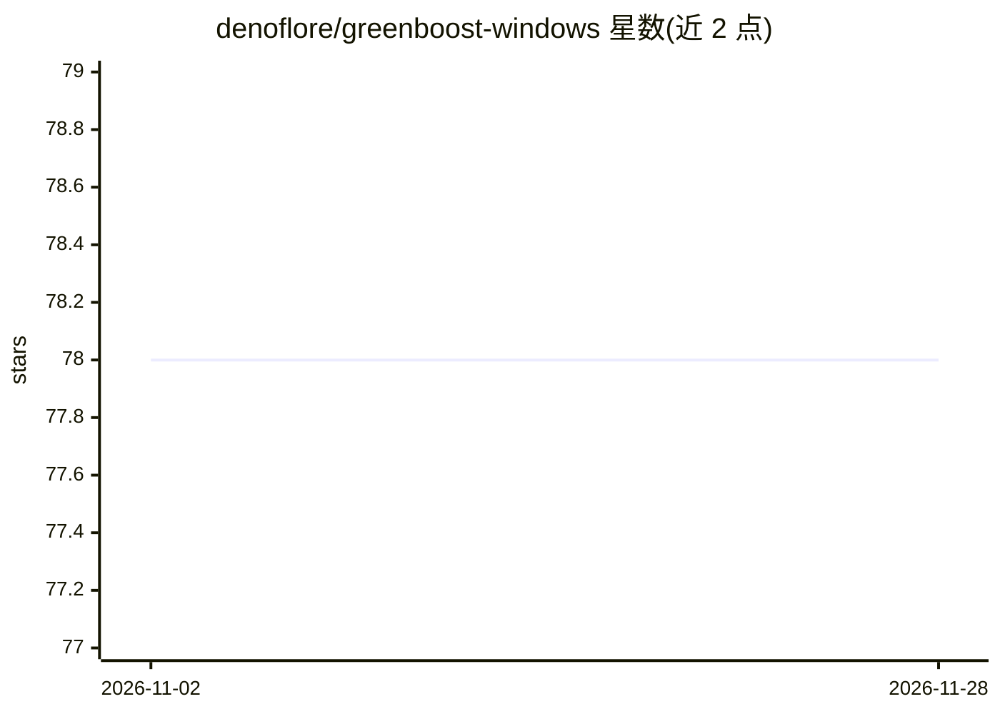

# denoflore/greenboost-windows

⭐ 78 · C · NOASSERTION · 推送 2026-11-02 · [GitHub](https://github.com/denoflore/greenboost-windows) · 个人维护

**Windows 版 GPU VRAM 扩展：用系统 RAM/NVMe 承载 MoE 专家权重跑更大 LLM**

GreenBoost 的 Windows 移植：针对量化 MoE GGUF 模型，将选定专家权重经固定 RAM 缓存装入有界 VRAM 池，其余专家由模型自身路由在 CUDA 需要时从 RAM 或 GGUF 文件加载，推理内核沿用固定版本 llama.cpp b12019 的 CUDA kernels，计算保留在 GPU。启动器与库为 MSVC 编译的原生 Windows C/C++ 二进制，无需 WSL。另一路径是便携 CUDA 分配 shim，可包装普通 CUDA 应用。README 明确声明最新卸载改动仅有源码、未经运行或基准测试，早期需求分页实现的验证仅限小模型短提示。构建需 VS Build Tools、CMake、Ninja 与 CUDA Toolkit。

## 筛选速览

| 维度 | 判定 | 备注 |
|---|---|---|
| AI 角色 | `ai-ecosystem` | LLM/agent 周边工具 |
| 许可风险 | `none` | NOASSERTION |
| 部署形态 | `desktop` | 安装包/桌面程序 |
| 模型依赖 | local-ok | 支持本地模型 |
| 硬件要求 | — | 无带数字的原话,不猜 |
| 安装摩擦 | `high` | 编译与系统依赖俱全 |
| 成熟度 | `idea` | |

## 能力要点

- MoE 专家权重经固定 RAM 缓存进入有界 VRAM 池，模型路由自选专家
- 原生 Windows C/C++ 实现（Win32 文件读取、NVIDIA Windows CUDA 驱动），无需 WSL
- 新增 CUDA 热专家追踪、有界预取与可选投机解码（源码态，未运行验证）
- 便携分配 shim 可包装普通 CUDA 应用，含常规 llama.cpp 工作流

## 适用场景

- MoE 模型专家权重超出 VRAM 容量时在 Windows 上运行
- 在单张 NVIDIA 卡上跑更大的量化 MoE GGUF 模型
- 为已有 CUDA 应用提供分配兜底（普通分配失败后托管内存回退）

## 场景标签

`推理引擎` · 领域:训练与推理

## 证据(README 行号)

> L5: **Keep selected model experts in VRAM and load the rest from RAM or a GGUF file when CUDA needs them.**
> L9: which experts run. GreenBoost loads their original bytes before the existing
> L10: llama.cpp CUDA kernels use them. Model calculations stay on the GPU.

## 星数曲线

2026-11-02 78 → 2026-11-28 78（+0）

---
*卡片 v1 · prompt 1.4 · 生成 2026-11-18 · 置信度 high · 依据 README sha `0595569e7ff0` · [字段定义](../../DATASET.md)*
