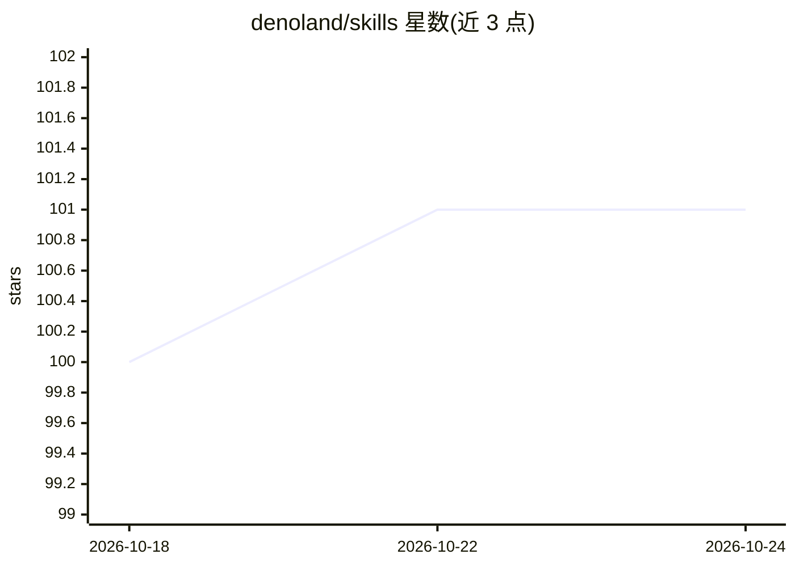

# denoland/skills

⭐ 101 · TypeScript · MIT · 推送 2026-07-29 · [GitHub](https://github.com/denoland/skills) · 组织维护

**Deno 官方维护的 AI 编程助手技能包：教助手用 Deno**

由 Deno 团队维护的 Agent Skills 技能集合，面向 Claude Code、Cursor、GitHub Copilot 等遵循 Agent Skills 规范的 AI 编程助手。包含 5 个技能：deno 核心技能（依赖管理、权限、工具链、发布）、Node/npm/yarn/pnpm/Bun 迁移、Deno Deploy 部署、Fresh 前端框架、@deno/sandbox 安全执行。目标 Deno 2.9+。提供 Claude Code 插件市场安装、npx skills 命令与手动 git clone 三种安装方式。

## 筛选速览

| 维度 | 判定 | 备注 |
|---|---|---|
| AI 角色 | `ai-knowledge` | 知识聚合/清单类 |
| 许可风险 | `permissive` | MIT |
| 部署形态 | `library` | 以包/库形式分发 |
| 模型依赖 | — | README 未给出锁定关系 |
| 硬件要求 | — | 无带数字的原话,不猜 |
| 安装摩擦 | `low` | 无编译、无系统依赖或容器化 |
| 成熟度 | — | 结构信号不足 |

## 能力要点

- 5 个技能覆盖 Deno 核心开发、迁移、部署、Fresh 前端与沙箱执行
- 2.0 版本将三个旧技能合并为单一 deno 技能
- 支持 Claude Code 插件市场、npx skills 与手动复制三种安装方式
- 遵循 Agent Skills Specification，可跨平台使用

## 适用场景

- 让 AI 编程助手按 Deno 当前最佳实践写代码
- 把 Node 项目迁移到 Deno 时获得助手指导
- 部署到 Deno Deploy 或构建 Fresh 应用时提供上下文知识

## 场景标签

 · 领域:Web 开发工具/Agent 技能

## 证据(README 行号)

> L3: Modern Deno development knowledge for AI coding assistants. These skills teach
> L138: For other AI coding assistants that support the Agent Skills specification, copy

## 星数曲线

2026-10-18 100 → 2026-10-24 101（+1）

---
*卡片 v1 · prompt 1.4 · 生成 2026-10-23 · 置信度 high · 依据 README sha `0e1310abb315` · [字段定义](../../DATASET.md)*
