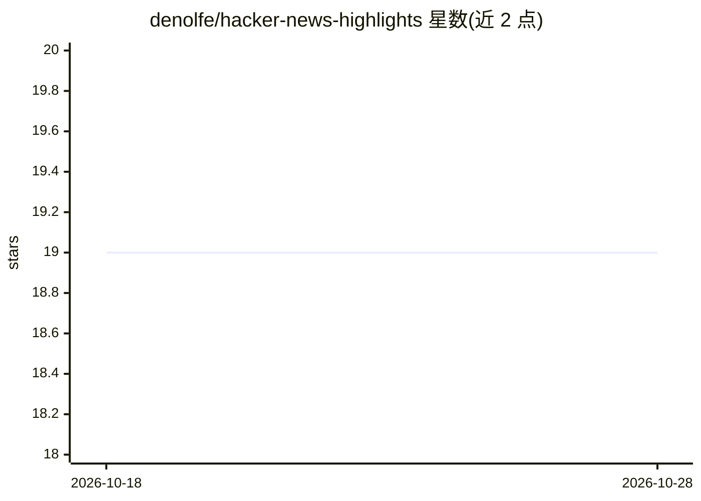

# denolfe/hacker-news-highlights

⭐ 19 · TypeScript · NOASSERTION · 推送 2026-10-28 · [GitHub](https://github.com/denolfe/hacker-news-highlights) · [官网](https://hacker-news-highlights.transistor.fm/) · 个人维护

**每日将 Hacker News 前 10 帖生成 AI 摘要播客**

自动化播客生产项目：每日抓取 Hacker News 前 10 篇帖文与热门评论，用 gpt-5.6-luna 模型生成摘要，经 OpenAI TTS 或 ElevenLabs 合成语音，自动上传至 Transistor.fm 发布播客，并可产出带截图与章节时间戳的 YouTube 视频 MP4。面向关注 Hacker News 内容的听众，由个人维护者以每日订阅播客形式提供。README 信息有限，未给出安装运行命令，仓库主要作为播客订阅入口而非可复用工具交付。

## 筛选速览

| 维度 | 判定 | 备注 |
|---|---|---|
| AI 角色 | `ai-native` | 本体是模型或模型工具 |
| 许可风险 | `none` | NOASSERTION |
| 部署形态 | `None` |  |
| 模型依赖 | — | README 未给出锁定关系 |
| 硬件要求 | — | 无带数字的原话,不猜 |
| 安装摩擦 | `low` | 无编译、无系统依赖或容器化 |
| 成熟度 | — | 结构信号不足 |

## 能力要点

- gpt-5.6-luna 生成帖文与热门评论摘要
- OpenAI TTS 或 ElevenLabs 双语音合成通道
- 自动上传 Transistor.fm 发布播客
- 输出带截图与章节时间戳的 YouTube MP4

## 适用场景

- 以播客形式每日获取 Hacker News 热帖摘要
- 在 YouTube 收看带章节的视频版摘要

## 场景标签

 · 领域:媒体/内容生成

## 证据(README 行号)

> L6: > Daily podcast summarizing Top 10 posts from Hacker News
> L12: - **AI Summaries**: gpt-5.6-luna summarizes story content and top comments

## 星数曲线

2026-10-18 19 → 2026-10-28 19（+0）

---
*卡片 v1 · prompt 1.4 · 生成 2026-10-28 · 置信度 mid · 依据 README sha `8ae7808ccb94` · [字段定义](../../DATASET.md)*
