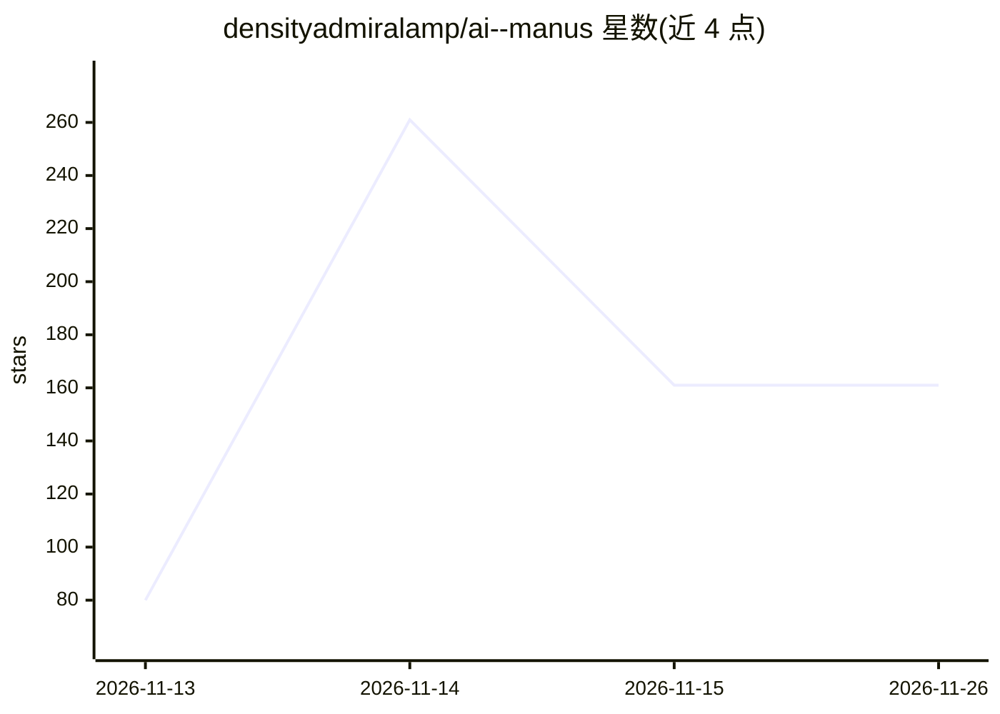

# densityadmiralamp/ai--manus

⭐ 161 · Apache-2.0 · 推送 2026-11-15 · [GitHub](https://github.com/densityadmiralamp/ai--manus) · 个人维护

**面向个人用户的自主 AI Agent，代跑代码与操控浏览器**

README 宣称 Manus 是一个自主 AI agent 应用：代替用户编写并执行脚本、打开网页并与之交互、完成多步骤任务，定位为家庭、学习与轻量办公场景的个人后台助手，而非企业平台。给出兼容性表（最低 4GB 内存、双核 CPU）与上手步骤（配置、测试、逐步扩大自动化范围），但未给出具体安装命令、技术架构或模型接入方式，正文以功能描述与下载指引（附促销码 PROMO2026）为主。

## 筛选速览

| 维度 | 判定 | 备注 |
|---|---|---|
| AI 角色 | `ai-native` | 本体是模型或模型工具 |
| 许可风险 | `permissive` | Apache-2.0 |
| 部署形态 | `None` |  |
| 模型依赖 | — | README 未给出锁定关系 |
| 硬件要求 | — | 无带数字的原话,不猜 |
| 安装摩擦 | `low` | 无编译、无系统依赖或容器化 |
| 成熟度 | — | 结构信号不足 |

## 能力要点

- 自主执行代码与浏览器控制两类操作
- 支持跨脚本与浏览器的多步骤任务
- 面向家庭、学习与小规模工作的个人助手定位
- 兼容性表列出最低 4GB 内存、双核 CPU 要求

## 适用场景

- 让 agent 代为查网页、填表单、汇总信息
- 跑小脚本、整理研究笔记与文件
- 后台处理日常重复性小任务

## 场景标签

`AI 助手` `浏览器自动化` · 领域:效率与自动化

## 证据(README 行号)

> L10: - **Autonomous Code Execution:** Manus AI agent runs code on its own to complete tasks, so you can focus on decisio
> L18: Manus is an autonomous AI agent designed to run code and control a browser on your behalf. Instead of acting like a

## 星数曲线

2026-11-13 80 → 2026-11-26 161（+81）

---
*卡片 v1 · prompt 1.4 · 生成 2026-11-17 · 置信度 mid · 依据 README sha `0f78ee3a5dd2` · [字段定义](../../DATASET.md)*
