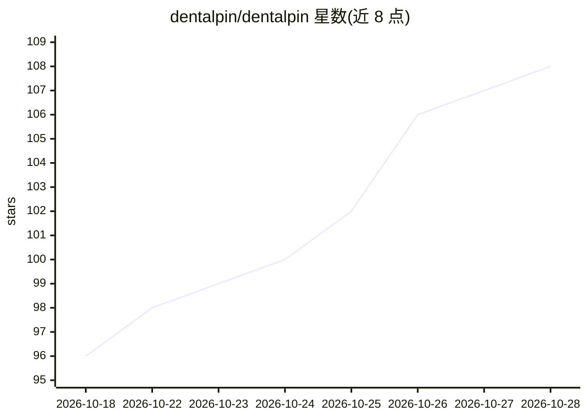

# dentalpin/dentalpin

⭐ 108 · Python · NOASSERTION · 推送 2026-10-28 · [GitHub](https://github.com/dentalpin/dentalpin) · [官网](https://www.dentalpin.com) · 组织维护

**面向牙科诊所的开源可自托管管理系统，内置 AI Copilot**

基于 FastAPI + Nuxt 4 + PostgreSQL 的牙科诊所管理软件（BSL 1.1，发布四年后转为 Apache 2.0），功能覆盖患者档案、牙位图、预约排班、治疗方案、预算/发票/收款与五角色 RBAC，界面支持十二种语言。内置 agentic AI Copilot：通过模块工具注册表调用与 UI 相同的操作执行多步任务，每次工具调用按用户 RBAC 复检权限，PHI 在发送 LLM 前以确定性令牌脱敏，写操作需用户确认；LLM 提供商、模型与令牌预算可按部署配置。提供 Docker 预构建镜像一键部署与在线演示站点。

## 筛选速览

| 维度 | 判定 | 备注 |
|---|---|---|
| AI 角色 | `ai-enhanced` | 去掉 AI 部分产品仍成立 |
| 许可风险 | `none` | NOASSERTION |
| 部署形态 | `self-host` | docker 或自建部署 |
| 模型依赖 | — | README 未给出锁定关系 |
| 硬件要求 | — | 无带数字的原话,不猜 |
| 安装摩擦 | `low` | 无编译、无系统依赖或容器化 |
| 成熟度 | — | 结构信号不足 |

## 能力要点

- 内置 agentic Copilot：规划并执行多步任务，工具调用按用户 RBAC 权限复检
- PHI 脱敏（姓名/电话/邮箱/ID 令牌化）默认开启，写操作需确认
- 模块化插件架构、API-first、十二语言界面
- 提供 Docker 预构建镜像与 Caddy TLS 一键部署

## 适用场景

- 牙科诊所自托管患者、排班、预算与收款管理
- 用自然语言让 Copilot 查患者、约号、记账并执行
- 多语言诊所团队按角色权限协作

## 场景标签

`AI 助手` · 领域:对话与助手

## 证据(README 行号)

> L15: **Source-available (BSL 1.1) dental clinic management software, converting to Apache 2.0 four years after publicati
> L16: treatment plans, billing and a built-in AI copilot — modular, self-hosted, API-first.
> L59: This isn't a chatbot bolted on top. The Copilot is a true agent that **plans and executes multi-step tasks** by cal
> L61: - **It does, not just answers.** The agent runs real tools — search patients, book or reschedule appointments, reco

## 星数曲线

2026-10-18 96 → 2026-10-28 108（+12）

---
*卡片 v1 · prompt 1.4 · 生成 2026-10-23 · 置信度 mid · 依据 README sha `5c85eee75f65` · [字段定义](../../DATASET.md)*
