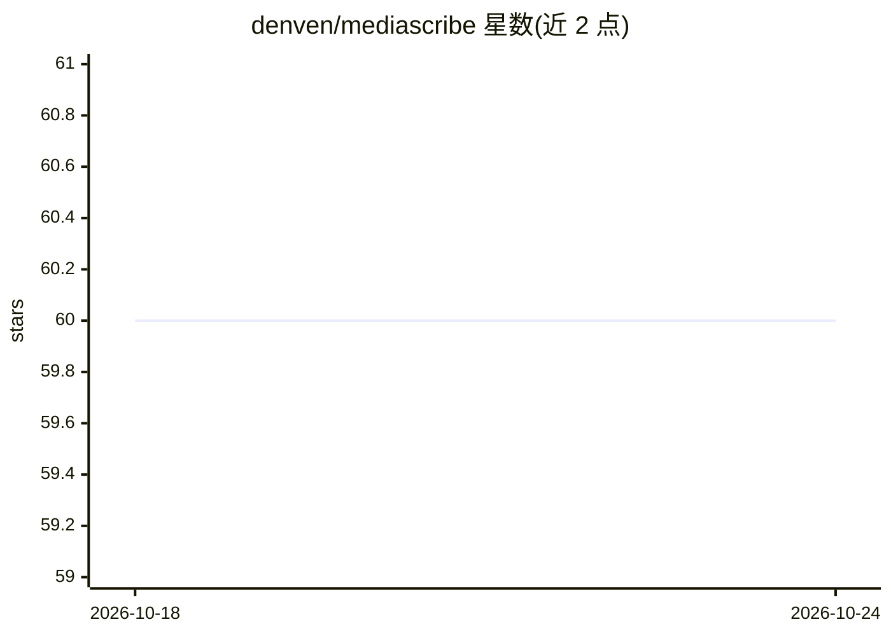

# denven/mediascribe

⭐ 54 · Python · MIT · 推送 2026-04-16 · [GitHub](https://github.com/denven/mediascribe) · 个人维护 · 中文 README

**音视频与文本转录+摘要的 CLI 工具，支持本地/云端后端**

Python CLI，提供音频转录、文本摘要与视频摘要的分阶段工作流：视频优先抓取字幕，无字幕时抽取音频走 ASR 再摘要。ASR 支持本地与云端 provider（Azure/阿里云/科大讯飞），摘要默认经 LiteLLM 路由到本地 Ollama 模型（qwen2.5:3b），也可切换云端模型。转录与摘要逻辑抽为独立服务，可在其他 Python 脚本中复用。通过 uv 建环境安装，支持说话人命名、远程视频（YouTube/Bilibili 等 yt-dlp 源）与 cookie 认证。本地 ASR/摘要对 CPU/GPU/RAM 有较高硬件要求。

## 筛选速览

| 维度 | 判定 | 备注 |
|---|---|---|
| AI 角色 | `ai-native` | 本体是模型或模型工具 |
| 许可风险 | `permissive` | MIT |
| 部署形态 | `None` |  |
| 模型依赖 | local-ok | 支持本地模型 |
| 硬件要求 | — | 无带数字的原话,不猜 |
| 安装摩擦 | `medium` | 含编译或系统依赖之一 |
| 成熟度 | — | 结构信号不足 |

## 能力要点

- 音视频文一站式：转录、摘要、视频字幕优先策略与 ASR 回退
- ASR provider 架构：local / azure / aliyun / iflytek
- 摘要默认本地 Ollama 模型（qwen2.5:3b），可切换云端模型
- 转录与摘要抽象为独立服务，可被其他 Python 脚本复用

## 适用场景

- 把会议录音转成带说话人名的转录稿并生成摘要
- 给本地或 YouTube/Bilibili 视频生成内容摘要
- 先出转录稿、之后再补摘要的分阶段工作流

## 场景标签

`语音识别` `AI 写作` · 领域:内容生成

## 证据(README 行号)

> L14: MediaScribe is a practical CLI for transcribing and summarizing audio, text, and video with reusable staged workflo
> L19: - Local and cloud ASR support with provider-based architecture
> L272: - Default path uses a local Ollama model: `ollama/qwen2.5:3b`

## 星数曲线

2026-10-18 60 → 2026-10-24 60（+0）

---
*卡片 v1 · prompt 1.4 · 生成 2026-10-24 · 置信度 high · 依据 README sha `78a92bac5487` · [字段定义](../../DATASET.md)*
