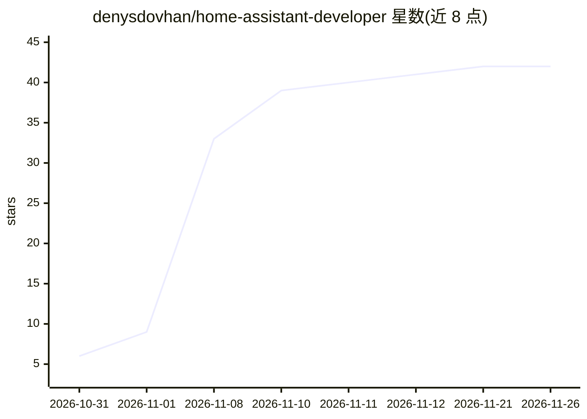

# denysdovhan/home-assistant-developer

⭐ 42 · JavaScript · MIT · 推送 2026-10-28 · [GitHub](https://github.com/denysdovhan/home-assistant-developer) · [官网](https://contributors.home-assistant.io/) · 个人维护

**开发 Home Assistant 集成与卡片的 agent 技能包**

为 Claude Code 与 OpenAI Codex 等 agent 提供两个开发技能：home-assistant-integration 用于构建与审查 Python 自定义集成（基于当前 Home Assistant 贡献者文档与质量规则），home-assistant-card 用于构建自定义 Lovelace 卡片及其编辑器。技能提供开发指导，不连接或控制 Home Assistant 实例。可通过 npx skills 命令、Codex 插件市场或 Claude Code 插件市场安装。开发本仓库需要 Make、Node.js 24+、uv 和 Claude Code。

## 筛选速览

| 维度 | 判定 | 备注 |
|---|---|---|
| AI 角色 | `ai-ecosystem` | LLM/agent 周边工具 |
| 许可风险 | `permissive` | MIT |
| 部署形态 | `library` | 以包/库形式分发 |
| 模型依赖 | locked-api |  |
| 硬件要求 | — | 无带数字的原话,不猜 |
| 安装摩擦 | `medium` | 含编译或系统依赖之一 |
| 成熟度 | — | 结构信号不足 |

## 能力要点

- 两个技能：Python 集成构建/审查与 Lovelace 卡片构建
- 基于当前 Home Assistant 贡献者文档与质量规则
- 支持独立技能、Codex 插件、Claude Code 插件三种安装方式
- 技能仅提供开发指导，不连接或控制 Home Assistant 实例

## 适用场景

- 让 agent 按 Home Assistant 文档脚手架生成自定义集成
- 构建带 config flow 和 DataUpdateCoordinator 的传感器集成
- 让 agent 按 Bronze 质量规则审查现有集成项目

## 场景标签

`提示工程` `代码生成` · 领域:Agent 开发

## 证据(README 行号)

> L7:  Agent skills for building Home Assistant custom integrations and Lovelace cards.
> L8:  Available as standalone skills or a plugin for OpenAI Codex and Claude Code.
> L40: These skills provide development instructions. They do not connect to or control a Home Assistant instance.

## 星数曲线

2026-10-31 6 → 2026-11-26 42（+36）

---
*卡片 v1 · prompt 1.4 · 生成 2026-11-18 · 置信度 high · 依据 README sha `14b944903680` · [字段定义](../../DATASET.md)*
