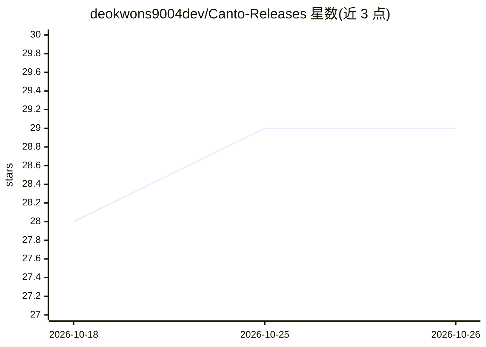

# deokwons9004dev/Canto-Releases

⭐ 29 · NOASSERTION · 推送 2026-10-25 · [GitHub](https://github.com/deokwons9004dev/Canto-Releases) · [官网](https://lonelyduck.io/canto) · 个人维护 · 中文 README

**在 Mac 本地运行 AI 的私人笔记本：带引用问答、研究与会议记录**

macOS 笔记本应用，AI 模型在 Mac 本地运行：在任意笔记旁提问并得到带编号引用的回答，点击引用可跳转原文；研究报告带证据台账（每条声明及来源与置信度）；会议在本机转写为含摘要、决策与行动项的笔记。笔记存储于本机加密数据库，出网功能在设置中逐项列出并各有开关。支持接入 Ollama、LM Studio、llama.cpp 服务或 OpenRouter。免费版覆盖单机核心功能，Pro 为一次性付费解锁深度研究、会议等功能。要求 Apple silicon（M1+）、macOS 14+、8GB 以上内存，8GB 机型运行 Small Mac 模式。专有软件，通过 dmg 安装。

## 筛选速览

| 维度 | 判定 | 备注 |
|---|---|---|
| AI 角色 | `ai-native` | 本体是模型或模型工具 |
| 许可风险 | `none` | NOASSERTION |
| 部署形态 | `desktop` | 安装包/桌面程序 |
| 模型依赖 | local-ok | 支持本地模型 |
| 硬件要求 | — | 无带数字的原话,不猜 |
| 安装摩擦 | `low` | 无编译、无系统依赖或容器化 |
| 成熟度 | `idea` | |

## 能力要点

- AI 全程在 Mac 本地运行，回答带编号引用并可跳转原文
- 研究报告附证据台账：每条声明的支持与反对来源及置信度
- 会议在本机转写并生成摘要、决策、行动项
- 模型按芯片与内存推荐，支持 Ollama/LM Studio/llama.cpp/OpenRouter

## 适用场景

- 在笔记旁直接提问并获得有出处的回答，核查信息来源
- 自动生成会议纪要（摘要、决策、行动项），数据不出 Mac
- 用本地模型做研究并生成带证据台账的报告
- 从 Apple Notes、Evernote、Obsidian 等迁移并统一管理笔记

## 场景标签

`知识库管理` `语音识别` · 领域:知识与检索

## 证据(README 行号)

> L6:  Notes, cited answers, research and meetings, with the AI running on your Mac.
> L23: Canto is a notebook where the AI runs on your Mac. Ask a question beside any note and the answer cites the passage 

## 星数曲线

2026-10-18 28 → 2026-10-26 29（+1）

---
*卡片 v1 · prompt 1.4 · 生成 2026-10-26 · 置信度 high · 依据 README sha `2833b849827f` · [字段定义](../../DATASET.md)*
