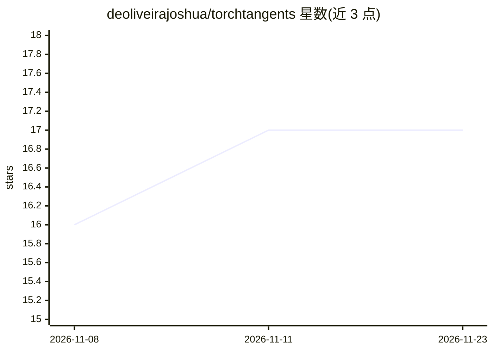

# deoliveirajoshua/torchtangents

⭐ 17 · Python · Apache-2.0 · 推送 2026-11-06 · [GitHub](https://github.com/deoliveirajoshua/torchtangents) · 个人维护

**PyTorch 版无限宽神经网络库：闭式计算 NNGP 与 NTK**

Google JAX 库 Neural Tangents 的 PyTorch 移植：在标准 PyTorch 中构建深度网络，并解析提取其无限宽极限下的 NNGP 核与 NTK 核。提供有状态 torch.nn.Module 层（可同时做有限宽前向与经验 NTK）、无状态 stax 核层、vanilla 模型自动转换（支持残差/分支结构）以及闭式无限宽训练与贝叶斯 GP 推断。要求 Python>=3.9、PyTorch>=2.2；支持 CPU 与 CUDA 12.x+ 的 NVIDIA GPU，torch.compile 在 Linux 与 Windows+WSL2 可用。

## 筛选速览

| 维度 | 判定 | 备注 |
|---|---|---|
| AI 角色 | `ai-native` | 本体是模型或模型工具 |
| 许可风险 | `permissive` | Apache-2.0 |
| 部署形态 | `library` | 以包/库形式分发 |
| 模型依赖 | — | README 未给出锁定关系 |
| 硬件要求 | — | 无带数字的原话,不猜 |
| 安装摩擦 | `medium` | 含编译或系统依赖之一 |
| 成熟度 | — | 结构信号不足 |

## 能力要点

- 闭式逐层递归计算 NNGP 与 NTK 核
- convert 子模块可转换已有的 vanilla torch.nn.Module（含残差/分支图）
- 闭式无限宽训练与 GP 推断（任意连续训练时刻 t 的预测）
- 支持 mini-batch 核计算与 torch.compile 加速

## 适用场景

- 在 PyTorch 里对已有模型提取经验 NTK 或无限宽核
- 用 GP 闭式解做无限宽网络的训练与预测，不跑优化循环
- 做 NTK/NNGP 理论相关的科研实验与基准测试

## 场景标签

`科研工具` · 领域:学习与行业

## 证据(README 行号)

> L8: **TorchTangents** (`torchtangents`) is a **PyTorch-native** port of Google's JAX-native Neural Tangents library. It 
> L45: |**`torchtangents.nn`**|Stateful `torch.nn.Module` drop-in layers (`Linear`, `Conv2d`, `ReLU`, `Sequential`, etc.)|
> L48: |**`torchtangents.predict`**|Closed-form infinite-width training & Bayesian GP inference (`gp_inference`, `gradient

## 星数曲线

2026-11-08 16 → 2026-11-23 17（+1）

---
*卡片 v1 · prompt 1.4 · 生成 2026-11-18 · 置信度 high · 依据 README sha `1ed2071917f1` · [字段定义](../../DATASET.md)*
