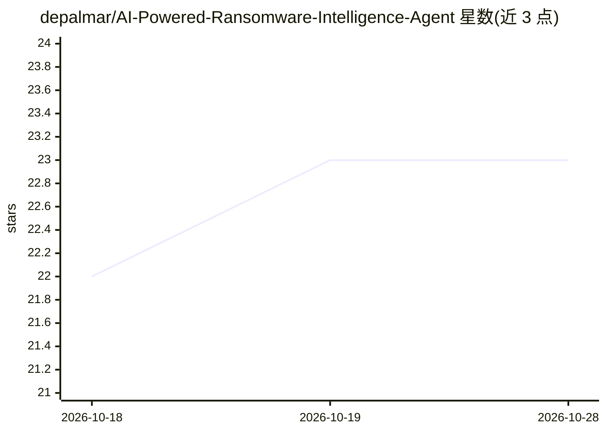

# depalmar/AI-Powered-Ransomware-Intelligence-Agent

⭐ 23 · Python · NOASSERTION · 推送 2026-04-15 · [GitHub](https://github.com/depalmar/AI-Powered-Ransomware-Intelligence-Agent) · 个人维护

**监控勒索软件威胁的 n8n 自动化工作流（Claude/Ollama 分析）**

面向安全分析人员的 n8n 工作流 JSON 集合（101/200 两级，各含 Claude 与本地 Ollama 版本）：定时抓取 ransomware.live API 的受害者与组织数据，经去标识、行业过滤、去重后由 LLM 做威胁分析，产出含 8 个 KPI 卡片、MITRE ATT&CK 表、5 张 Chart.js 图表的 HTML 报告，并推送 Slack、Google Docs 与邮件；200 级增加 VirusTotal/AbuseIPDB IOC 富化、YARA 规则与 JIRA 集成。附模拟 API 服务器用于离线演示。需自行准备 n8n 实例与对应 API 凭据。

## 筛选速览

| 维度 | 判定 | 备注 |
|---|---|---|
| AI 角色 | `ai-native` | 本体是模型或模型工具 |
| 许可风险 | `none` | NOASSERTION |
| 部署形态 | `None` |  |
| 模型依赖 | local-ok | 支持本地模型 |
| 硬件要求 | — | 无带数字的原话,不猜 |
| 安装摩擦 | `low` | 无编译、无系统依赖或容器化 |
| 成熟度 | — | 结构信号不足 |

## 能力要点

- 101/200 两级工作流，均提供 Claude 与本地 Ollama 双版本
- 输出含 8 KPI 卡片、MITRE ATT&CK 映射表与 5 张图表的 HTML 威胁简报
- 200 级支持 VirusTotal/AbuseIPDB IOC 富化、YARA 规则、邮件与 JIRA 交付
- 附 mock_api 模拟 ransomware.live 数据源，支持离线演示

## 适用场景

- 安全团队持续监控勒索软件泄露站并自动生成威胁简报
- 按行业过滤追踪特定领域的勒索攻击受害者
- 配合 SANS 勒索软件情报课程做教学演示

## 场景标签

`工作流自动化` `网络安全` · 领域:效率与自动化

## 证据(README 行号)

> L11: Automated threat intelligence pipelines that continuously monitor ransomware leak sites, run AI-powered analysis, a
> L105:      → AI Threat Analysis (Claude / Ollama) → Enhance Brief

## 星数曲线

2026-10-18 22 → 2026-10-28 23（+1）

---
*卡片 v1 · prompt 1.4 · 生成 2026-10-27 · 置信度 high · 依据 README sha `230485a866b2` · [字段定义](../../DATASET.md)*
