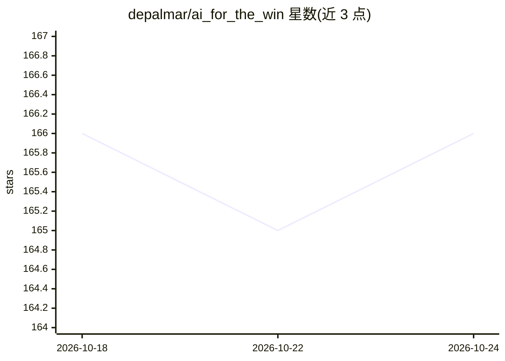

# depalmar/ai_for_the_win

⭐ 167 · Python · NOASSERTION · 推送 2026-09-25 · [GitHub](https://github.com/depalmar/ai_for_the_win) · [官网](https://depalmar.github.io/ai_for_the_win/) · 个人维护

**面向安全从业者的 AI 安全实战训练课程：50+ 实验、4 个毕业项目、18 个 CTF 题**

由个人作者维护的动手训练项目，教安全从业者用 ML 与 LLM 构建威胁检测、事件响应与安全自动化工具。含 50+ 个实验（含钓鱼分类器、LLM 日志分析、勒索软件检测、RAG、云安全等）、4 个毕业项目与 18 个 CTF 题，附数据集、解答与 Docker 实验环境（Jupyter、Elasticsearch、Ollama 等服务）。实验 00-13 无需 API key，14+ 需要一个 LLM API key（Anthropic/OpenAI/Google 任一）。本地安装要求 Python 3.10-3.12、Git，Docker 可选；采用个人免费、商用需许可的双许可。

## 筛选速览

| 维度 | 判定 | 备注 |
|---|---|---|
| AI 角色 | `ai-knowledge` | 知识聚合/清单类 |
| 许可风险 | `none` | NOASSERTION |
| 部署形态 | `self-host` | docker 或自建部署 |
| 模型依赖 | local-ok | 支持本地模型 |
| 硬件要求 | — | 无带数字的原话,不猜 |
| 安装摩擦 | `low` | 无编译、无系统依赖或容器化 |
| 成熟度 | — | 结构信号不足 |

## 能力要点

- 50+ 实验覆盖 ML、LLM、RAG、检测、DFIR、红队与云安全
- 提供 Docker 实验环境（含 Ollama 本地 LLM、ChromaDB、Elasticsearch 等服务）
- 实验 00-13 免费无需 API key，LLM 实验支持 Claude/GPT/Gemini 多提供商
- 附 Colab notebook，可浏览器直接运行

## 适用场景

- 安全从业者系统学习用 ML/LLM 构建检测与响应工具
- 蓝队/SOC/IR 人员按角色路径学习 AI 安全技能
- 以 CTF 挑战和毕业项目实践 AI 安全工程

## 场景标签

`网络安全` `教程课程` · 领域:学习与行业

## 证据(README 行号)

> L14: A hands-on training program for security practitioners who want to build AI-powered tools for threat detection, inc
> L133: **Legend:** Grey Foundation (00-09, Free) | Green ML Foundations (10-13, Free) | Purple LLM Basics (14-18) | Orang
> L215: |Project|Difficulty|Focus|

## 星数曲线

2026-10-18 166 → 2026-10-24 166（+0）

---
*卡片 v1 · prompt 1.4 · 生成 2026-10-22 · 置信度 mid · 依据 README sha `906d0dd9af3f` · [字段定义](../../DATASET.md)*
