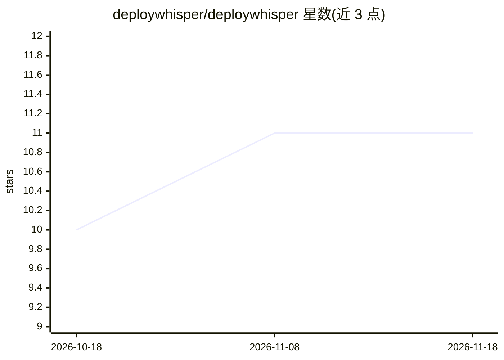

# deploywhisper/deploywhisper

⭐ 11 · Python · MIT · 推送 2026-11-17 · [GitHub](https://github.com/deploywhisper/deploywhisper) · [官网](https://deploywhisper.dev) · 组织维护

**给平台/DevOps 团队的部署前基础设施变更风险审查平台**

面向平台工程师、DevOps 团队与 SRE 的部署前风险审查平台：上传 Terraform、Kubernetes、Ansible、Jenkins、CloudFormation 产物，经解析归一化后输出包含风险评分、爆炸半径、回滚建议与英文叙述的咨询式简报。单容器应用（React + FastAPI + SQLite），LLM 叙述层通过官方 SDK 接入 OpenAI/Anthropic/Gemini，本地模式走 Ollama HTTP 适配器；评分本身为确定性流程，输出定位为建议性、需人工复核，本地优先处理 IaC 且不持久化 API key。提供 Web、REST API 与 CLI 三种入口，另有 GitHub Action 与 ghcr 容器发布。

## 筛选速览

| 维度 | 判定 | 备注 |
|---|---|---|
| AI 角色 | `ai-enhanced` | 去掉 AI 部分产品仍成立 |
| 许可风险 | `permissive` | MIT |
| 部署形态 | `self-host` | docker 或自建部署 |
| 模型依赖 | local-ok | 支持本地模型 |
| 硬件要求 | — | 无带数字的原话,不猜 |
| 安装摩擦 | `low` | 无编译、无系统依赖或容器化 |
| 成熟度 | `idea` | |

## 能力要点

- 多工具产物统一分析：Terraform/K8s/Ansible/Jenkins/CloudFormation 走同一管道
- 确定性风险评分 + LLM 英文叙述简报，输出显式标注为建议性、需人工复核
- 爆炸半径分析（服务拓扑图）与回滚方案生成（含复杂度信号）
- 内置公共风险模式与事件历史匹配；支持 SARIF/Semgrep 扫描器结果导入

## 适用场景

- 发布上线前对 Terraform/K8s 变更做一次风险评估初审
- 人工审批会前查看变更为何有风险、影响哪些资源、如何回滚
- 在 CI 中通过 CLI 或 GitHub Action 对 PR 的基础设施变更出咨询报告

## 场景标签

`代码审查` · 领域:编码与开发

## 证据(README 行号)

> L7: DeployWhisper helps platform engineers, DevOps teams, and SREs review deployment artifacts before release. It analyz
> L96: - **LLM-assisted narrative**: connect deterministic scoring with plain-English deployment guidance using Ollama, Op
> L122: - Teams can build trust gradually because reports keep deterministic evidence visible even when LLM narrative is e

## 星数曲线

2026-10-18 10 → 2026-11-18 11（+1）

---
*卡片 v1 · prompt 1.4 · 生成 2026-11-18 · 置信度 mid · 依据 README sha `0cb72266191e` · [字段定义](../../DATASET.md)*
