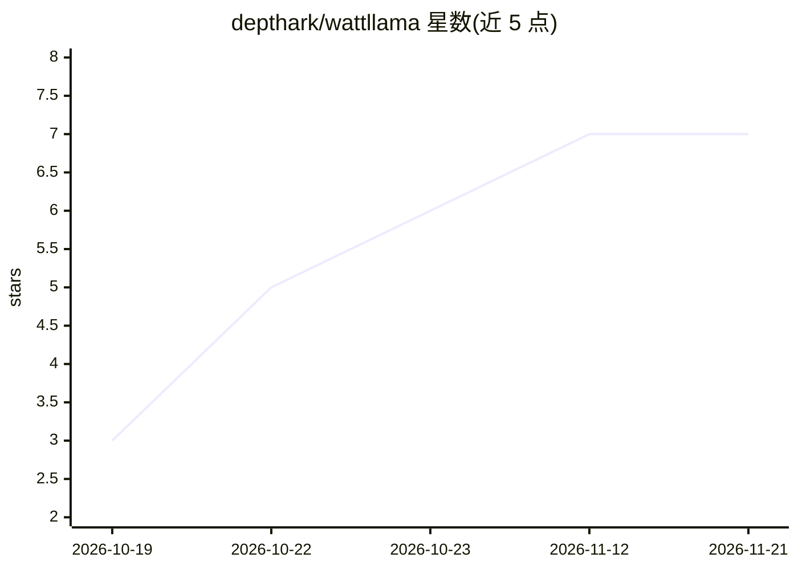

# depthark/wattllama

⭐ 7 · JavaScript · MIT · 推送 2026-11-01 · [GitHub](https://github.com/depthark/wattllama) · 个人维护

**本地 LLM 功耗仪表盘：实时统计电力、温度与每 token 能耗**

面向在本地运行 llama.cpp、Ollama 或 LM Studio 的 Windows/Linux 用户，以单个 Node.js 进程提供实时功耗、温度与能耗仪表盘。机制：监测推理引擎的端口与日志获取 token 与生成状态，配合 nvidia-smi 等读取硬件数据，输出每模型能耗、每千 token 瓦时、日×小时热力图与效率对比表，支持 CSV 导出、报警与社区结果分享。无驱动、无管理员权限、零依赖；GPU 与推理引擎为可选，缺省时仅显示 CPU 与系统功耗。

## 筛选速览

| 维度 | 判定 | 备注 |
|---|---|---|
| AI 角色 | `ai-ecosystem` | LLM/agent 周边工具 |
| 许可风险 | `permissive` | MIT |
| 部署形态 | `self-host` | docker 或自建部署 |
| 模型依赖 | local-ok | 支持本地模型 |
| 硬件要求 | — | 无带数字的原话,不猜 |
| 安装摩擦 | `low` | 无编译、无系统依赖或容器化 |
| 成熟度 | — | 结构信号不足 |

## 能力要点

- 实时功耗、温度与每 token 能耗统计，按模型分别记录
- 监测 llama.cpp、Ollama、LM Studio 三个引擎，多个模型同时统计
- 日×小时热力图、GPU 功耗限制效率表、CSV 导出与 PDF 报告
- GPU/CPU 过热、引擎停止、日能耗预算等报警，支持 Discord/ntfy/Slack webhook

## 适用场景

- 查看本地跑 LLM 时电脑的实时功耗与累计电费
- 对比不同 GPU 功耗限制下的推理效率
- 统计每天/每周/每月 LLM 推理消耗的电量

## 场景标签

 · 领域:硬件监控/本地 LLM 工具

## 证据(README 行号)

> L6:  A live power, temperature and energy-per-token dashboard for Windows and Linux PCs running
> L35: It does not matter which chat app, agent or IDE plugin you use: WattLlama watches the **engine**,
> L43: |🦙 **Every model separately**|llama.cpp (server or router), Ollama and LM Studio, several models and engines at onc

## 星数曲线

2026-10-19 3 → 2026-11-21 7（+4）

---
*卡片 v1 · prompt 1.4 · 生成 2026-11-20 · 置信度 mid · 依据 README sha `55b27637b0e2` · [字段定义](../../DATASET.md)*
