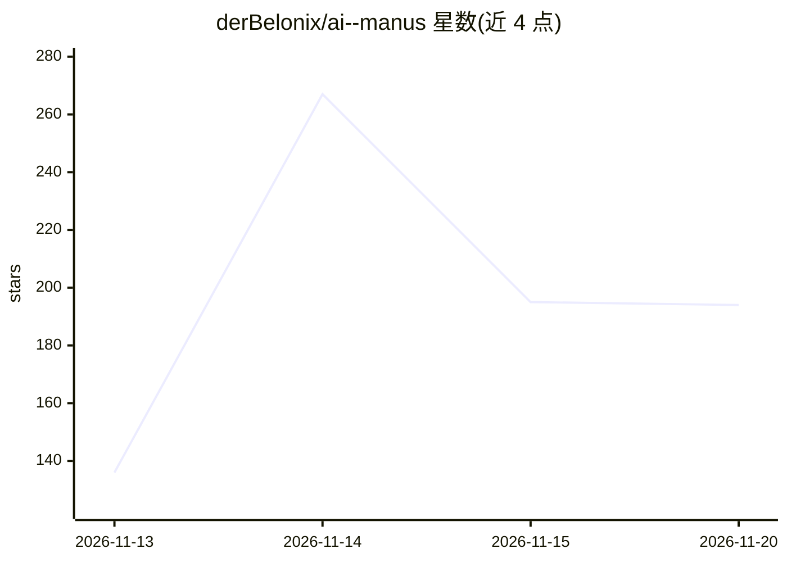

# derBelonix/ai--manus

⭐ 194 · Apache-2.0 · 推送 2026-11-14 · [GitHub](https://github.com/derBelonix/ai--manus) · 个人维护

**面向个人用户的自主 AI Agent：可执行代码与控制浏览器完成多步任务**

README 描述的自主 AI 代理：以用户指令驱动，可编写并执行脚本、控制浏览器导航网页、填表与收集信息，并跨会话重复执行同类工作流。定位为面向家庭、学习与轻量办公场景的个人助手，而非企业平台。文档给出系统兼容性表（双核 CPU、4GB 内存起步，推荐 8GB）与上手步骤，但未提供具体安装命令、模型接入方式或代码仓库结构说明。

## 筛选速览

| 维度 | 判定 | 备注 |
|---|---|---|
| AI 角色 | `ai-native` | 本体是模型或模型工具 |
| 许可风险 | `permissive` | Apache-2.0 |
| 部署形态 | `None` |  |
| 模型依赖 | — | README 未给出锁定关系 |
| 硬件要求 | — | 无带数字的原话,不猜 |
| 安装摩擦 | `low` | 无编译、无系统依赖或容器化 |
| 成熟度 | — | 结构信号不足 |

## 能力要点

- 自主执行代码与脚本运行
- 浏览器控制：导航、填表、信息收集
- 脚本与浏览器操作可在同一任务流中衔接
- 面向家庭、学习与轻量办公的小规模场景

## 适用场景

- 让代理替我完成重复性的网页查询与表单填写
- 组织研究笔记、跑小脚本等学习类任务
- 多页信息汇总与小报告准备

## 场景标签

`AI 助手` `浏览器自动化` `工作流自动化` · 领域:效率与自动化

## 证据(README 行号)

> L10: - **Autonomous Code Execution:** Manus AI agent runs code on its own to complete tasks, so you can focus on decisio
> L18: Manus is an autonomous AI agent designed to run code and control a browser on your behalf. Instead of acting like a

## 星数曲线

2026-11-13 136 → 2026-11-20 194（+58）

---
*卡片 v1 · prompt 1.4 · 生成 2026-11-17 · 置信度 low · 依据 README sha `885ad01e4b6b` · [字段定义](../../DATASET.md)*
