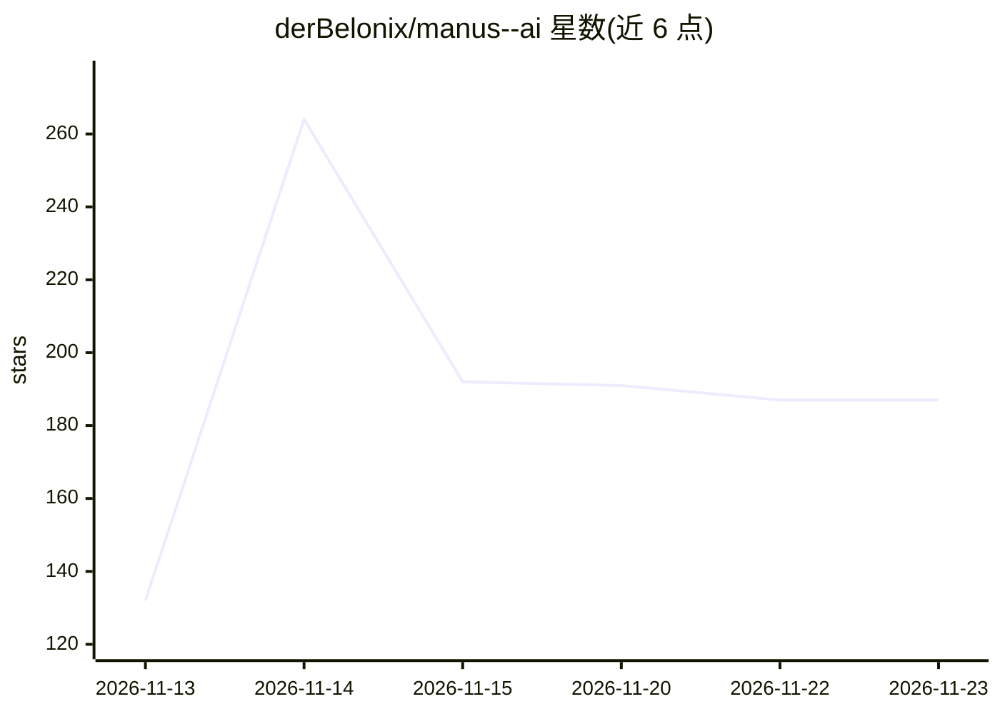

# derBelonix/manus--ai

⭐ 187 · Apache-2.0 · 推送 2026-11-14 · [GitHub](https://github.com/derBelonix/manus--ai) · 个人维护

**面向个人用户的自主 AI Agent：代为执行代码与浏览器操作**

README 描述的 Manus 是面向家庭、学习与轻量办公场景的自主 AI 代理：用户以自然语言下达指令，代理自行编写并执行脚本、控制浏览器（导航、填表、抓取信息），并以多步骤任务在后台完成重复性工作。定位明确排除重型企业平台，面向学生、远程工作者等非开发者。README 未给出任何安装命令、模型接入方式或技术实现细节，仅给出硬件兼容表与使用步骤描述；页面顶部含 'Download Manus / PROMO2026' 字样，无实质技术内容。

## 筛选速览

| 维度 | 判定 | 备注 |
|---|---|---|
| AI 角色 | `ai-native` | 本体是模型或模型工具 |
| 许可风险 | `permissive` | Apache-2.0 |
| 部署形态 | `None` |  |
| 模型依赖 | — | README 未给出锁定关系 |
| 硬件要求 | — | 无带数字的原话,不猜 |
| 安装摩擦 | `low` | 无编译、无系统依赖或容器化 |
| 成熟度 | — | 结构信号不足 |

## 能力要点

- 自主执行代码：代理自行编写并运行脚本完成任务
- 浏览器控制：导航网页、填写表单、收集信息
- 脚本与浏览器动作可在同一工作流中衔接
- 面向非开发者的小型任务委派定位

## 适用场景

- 让学生整理研究笔记、跑小型计算脚本
- 让代理跨多个网页收集数据并准备摘要
- 把重复性的小任务委派给后台代理处理

## 场景标签

`编码 Agent` `浏览器自动化` · 领域:效率与自动化

## 证据(README 行号)

> L18: Manus is an autonomous AI agent designed to run code and control a browser on your behalf. Instead of acting like a
> L22: Manus is not a heavy studio suite or a complex enterprise platform. It is a focused helper built for home, study, a

## 星数曲线

2026-11-13 132 → 2026-11-23 187（+55）

---
*卡片 v1 · prompt 1.4 · 生成 2026-11-17 · 置信度 mid · 依据 README sha `885ad01e4b6b` · [字段定义](../../DATASET.md)*
