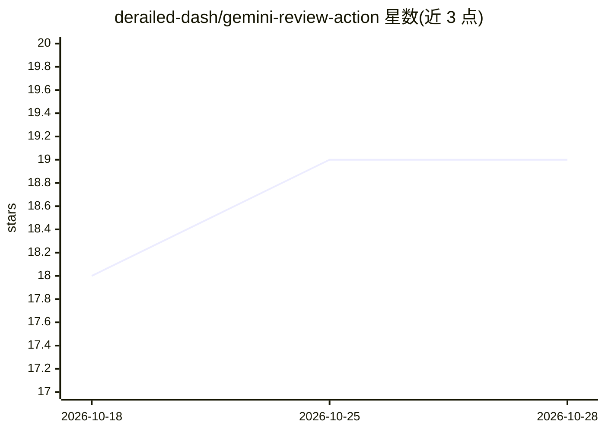

# derailed-dash/gemini-review-action

⭐ 19 · Python · MIT · 推送 2026-10-17 · [GitHub](https://github.com/derailed-dash/gemini-review-action) · [官网](https://github.com/derailed-dash/gemini-review-action) · 个人维护

**给 GitHub 仓库的 Gemini 自动 PR 代码评审与 Issue 分类 Action**

以 GitHub Action（原生 composite，非容器化）形式安装到 CI/CD 流水线，调用 Google Gemini 模型（默认 Gemini 3.8 Flash）对 Pull Request diff 生成行级代码评审意见，并对 Issue 自动打标签、定优先级。评审时按仓库大小自动加载全量或稀疏代码上下文，超过约 32k token 时自动使用 Gemini 服务端 Context Caching。支持 Gemini API Key 或 Google Cloud WIF 认证、Pydantic 结构化输出、TOML 自定义提示词与 `.agents/skills` 技能加载。

## 筛选速览

| 维度 | 判定 | 备注 |
|---|---|---|
| AI 角色 | `ai-native` | 本体是模型或模型工具 |
| 许可风险 | `permissive` | MIT |
| 部署形态 | `self-host` | docker 或自建部署 |
| 模型依赖 | — | README 未给出锁定关系 |
| 硬件要求 | — | 无带数字的原话,不猜 |
| 安装摩擦 | `low` | 无编译、无系统依赖或容器化 |
| 成熟度 | — | 结构信号不足 |

## 能力要点

- 行级 PR 评审与 Issue 自动分类打标（Gemini 3.8 Flash 默认）
- 按仓库大小切换全量/稀疏上下文，超 32k token 自动服务端缓存复用
- 多模态支持：PR 图片视觉 diff、Issue 截图识别（PNG/JPEG/WebP/GIF/SVG/PDF）
- 输出 GitHub suggestion 块支持一键应用，带 token 用量与成本估算报告

## 适用场景

- 在 CI/CD 中自动评审 Pull Request 并给出可一键应用的建议
- 自动为新增 Issue 打标签、定优先级
- 按仓库维度归集 Gemini 调用成本（Vertex AI Billing 标签）

## 场景标签

`代码审查` · 领域:编码与开发

## 证据(README 行号)

> L9: **Automated, Google Gemini-based Pull Request reviews and Issue Triaging for all your GitHub repositories and CI/CD 
> L21: - **AI-Powered Code Reviews**: Automated, constructive line-specific feedback on Pull Requests using Google Gemini 
> L31: - **Triggers**: The action triggers automatically in response to PR events. It can also be triggered by posting a c

## 星数曲线

2026-10-18 18 → 2026-10-28 19（+1）

---
*卡片 v1 · prompt 1.4 · 生成 2026-10-28 · 置信度 mid · 依据 README sha `e45af226963f` · [字段定义](../../DATASET.md)*
