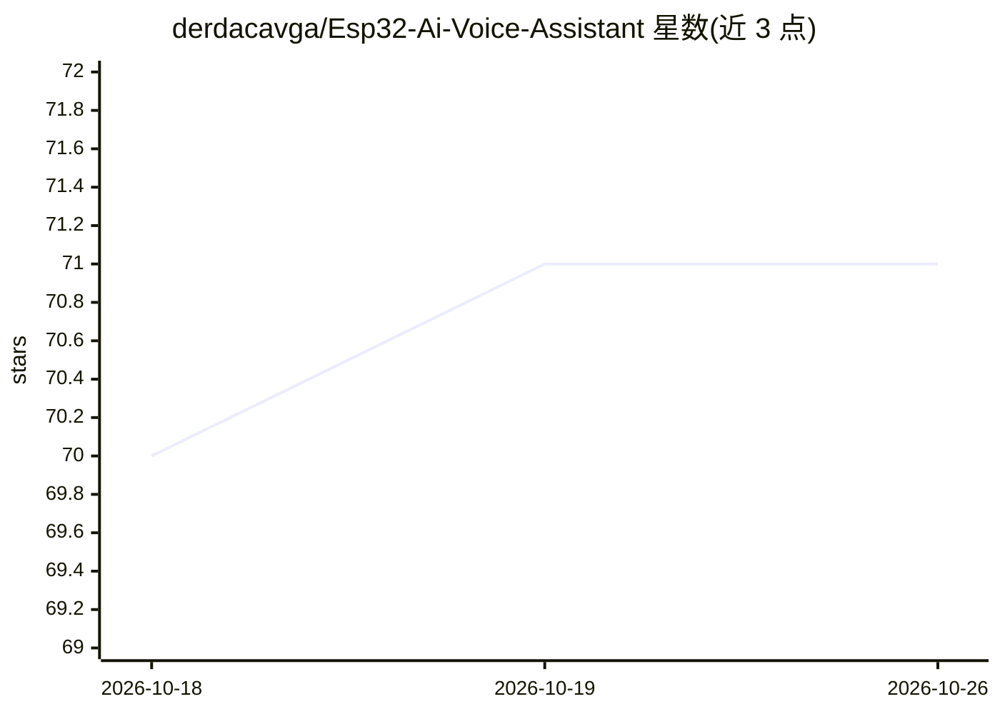

# derdacavga/Esp32-Ai-Voice-Assistant

⭐ 71 · C++ · GPL-3.0 · 推送 2025-11-22 · [GitHub](https://github.com/derdacavga/Esp32-Ai-Voice-Assistant) · 个人维护

**给创客的 ESP32-S3 免费 DIY AI 语音助手搭建教程**

硬件制作项目：ESP32-S3 开发板负责录音与音频播放（INMP441 麦克风、MAX98357A 功放、ST7789 显示屏、按键触发），AI 处理跑在免费 HuggingFace Space 的 Docker 服务器上，流程为 STT→LLM→TTS，回答音频回传板子自动播放。需要 8MB PSRAM 的 ESP32-S3（PSRAM 为强制要求），仅支持英语。配套视频教程，服务端文件含 Dockerfile/app.py/requirements.txt，固件用 Arduino IDE 上传。

## 筛选速览

| 维度 | 判定 | 备注 |
|---|---|---|
| AI 角色 | `ai-native` | 本体是模型或模型工具 |
| 许可风险 | `viral` | GPL-3.0 |
| 部署形态 | `self-host` | docker 或自建部署 |
| 模型依赖 | — | README 未给出锁定关系 |
| 硬件要求 | — | 无带数字的原话,不猜 |
| 安装摩擦 | `low` | 无编译、无系统依赖或容器化 |
| 成熟度 | — | 结构信号不足 |

## 能力要点

- ESP32-S3 录音/播放 + HuggingFace Space 云端 AI 处理的分工架构
- STT→LLM→TTS 全免费方案，无需付费 API
- 硬件清单明确：INMP441 麦克风、MAX98357A 功放、ST7789 屏、按键触发
- 按键按住录音、松开发送，回答自动播放

## 适用场景

- 自制一个不依赖付费 API 的桌面语音问答设备
- 学习 ESP32 与云端 AI 服务（STT/LLM/TTS）的集成
- 按教程复现硬件接线与 Arduino 固件配置

## 场景标签

`语音 Agent` `教程课程` · 领域:对话与助手

## 证据(README 行号)

> L3: This project guides you through building your very own **AI Voice Assistant** using completely **free** tools and AI
> L12: * **HuggingFace Integration:** Utilizes a custom server setup on HuggingFace to combine Speech-to-Text (STT), a Lar
> L65: * The AI server processes the request (STT -> LLM -> TTS), and sends the response audio back to the ESP32.

## 星数曲线

2026-10-18 70 → 2026-10-26 71（+1）

---
*卡片 v1 · prompt 1.4 · 生成 2026-10-24 · 置信度 high · 依据 README sha `49c60ced1cbc` · [字段定义](../../DATASET.md)*
