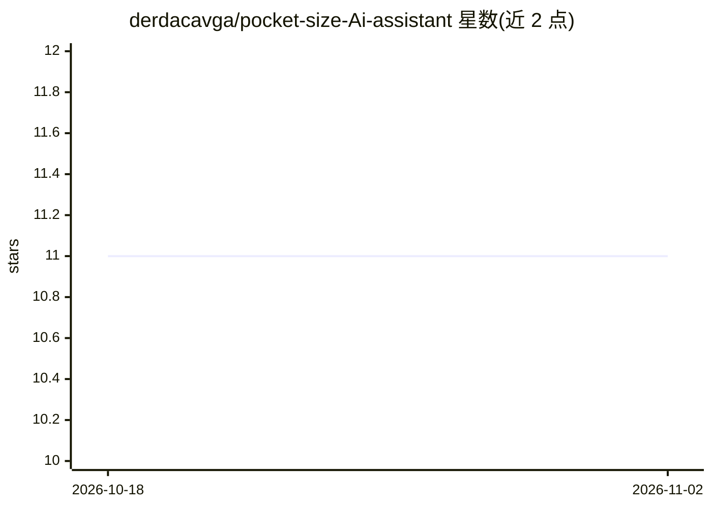

# derdacavga/pocket-size-Ai-assistant

⭐ 11 · C++ · GPL-3.0 · 推送 2025-11-22 · [GitHub](https://github.com/derdacavga/pocket-size-Ai-assistant) · 个人维护

**ESP32-C3 硬件 DIY AI 语音助手，云端模型实时应答**

基于 ESP32-C3 的 DIY 语音助手项目：开发板作为客户端采集 I2S 麦克风（INMP441）语音输入，AI 模型运行在 Hugging Face 云端，回答以 WAV 流式音频实时回传播放（MAX98357A 功放），SSD1306 OLED 显示信息，配 Fusion 360 设计的 3D 打印外壳。README 指向 YouTube 视频获取完整服务器搭建与安装配置步骤，本页未直接给出安装命令。按钮触发，免提语音唤醒为计划功能。GPL-3.0 许可。

## 筛选速览

| 维度 | 判定 | 备注 |
|---|---|---|
| AI 角色 | `ai-native` | 本体是模型或模型工具 |
| 许可风险 | `viral` | GPL-3.0 |
| 部署形态 | `None` |  |
| 模型依赖 | — | README 未给出锁定关系 |
| 硬件要求 | — | 无带数字的原话,不猜 |
| 安装摩擦 | `low` | 无编译、无系统依赖或容器化 |
| 成熟度 | — | 结构信号不足 |

## 能力要点

- ESP32-C3 作客户端、AI 模型运行在 Hugging Face 云端
- WAV 流式播放替代 v1 的 MP3 下载模式
- INMP441 麦克风 + MAX98357A 功放 + SSD1306 OLED 组合
- Fusion 360 设计的 3D 打印外壳（STL 可下载）

## 适用场景

- 自制便携式 AI 语音对话硬件设备
- 学习 ESP32 与云端 LLM 的流式语音交互实现
- 按接线图与视频教程复刻嵌入式 AI 助手

## 场景标签

`语音 Agent` · 领域:对话与助手

## 证据(README 行号)

> L27: The AI model runs on Hugging Face, while the ESP32-C3 works as a client handling voice input and real-time AI audio
> L31: ✅ Real-time AI voice responses
> L33: ✅ Hugging Face cloud AI integration

## 星数曲线

2026-10-18 11 → 2026-11-02 11（+0）

---
*卡片 v1 · prompt 1.4 · 生成 2026-11-02 · 置信度 mid · 依据 README sha `cca984bb1242` · [字段定义](../../DATASET.md)*
