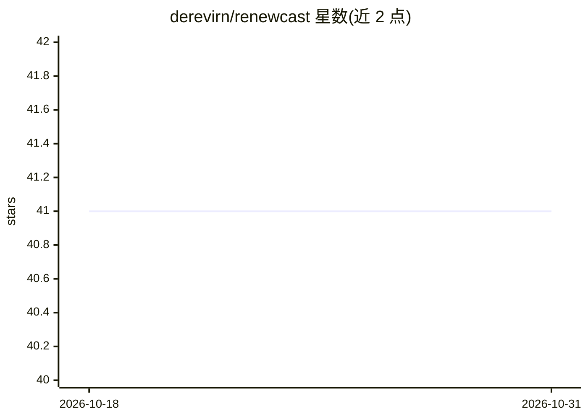

# derevirn/renewcast

⭐ 41 · Jupyter Notebook · 推送 2026-05-27 · [GitHub](https://github.com/derevirn/renewcast) · [官网](http://renewcast.giannis.io) · 个人维护

**欧盟各国可再生能源发电量预测的 Streamlit 仪表盘应用**

基于 Streamlit 与 PyCaret 构建的仪表盘应用，提供欧盟各国可再生能源发电量的时间序列预测。用户可选择国家与预测模型，模型范围覆盖经典统计方法到机器学习模型。应用已部署至 Oracle Cloud 并提供在线访问链接。安装时需按 requirements.txt 中给定顺序手动逐个安装依赖包以避免冲突。作者另发布了基于 Streamlit 与 sktime 的 Towards Data Science 文章，且注明源码在文章发布后已大幅更新，旧版本需单独查看。

## 筛选速览

| 维度 | 判定 | 备注 |
|---|---|---|
| AI 角色 | `ai-native` | 本体是模型或模型工具 |
| 许可风险 | `none` | — |
| 部署形态 | `None` |  |
| 模型依赖 | — | README 未给出锁定关系 |
| 硬件要求 | — | 无带数字的原话,不猜 |
| 安装摩擦 | `low` | 无编译、无系统依赖或容器化 |
| 成熟度 | — | 结构信号不足 |

## 能力要点

- 提供欧盟各国可再生能源发电量预测
- 支持选择国家与预测模型（经典方法到机器学习）
- 基于 Streamlit 与 PyCaret 构建，已部署至 Oracle Cloud

## 适用场景

- 查看欧盟某国可再生能源发电量的预测结果
- 对比不同经典与机器学习预测模型的输出
- 作为 Streamlit + PyCaret 时序预测应用的参考实现

## 场景标签

`数据分析` · 领域:效率与自动化

## 证据(README 行号)

> L2: A dashboard app that provides forecasts for renewable electricity generation in EU countries, based on Streamlit and

## 星数曲线

2026-10-18 41 → 2026-10-31 41（+0）

---
*卡片 v1 · prompt 1.4 · 生成 2026-10-25 · 置信度 high · 依据 README sha `7902f5f87fa4` · [字段定义](../../DATASET.md)*
