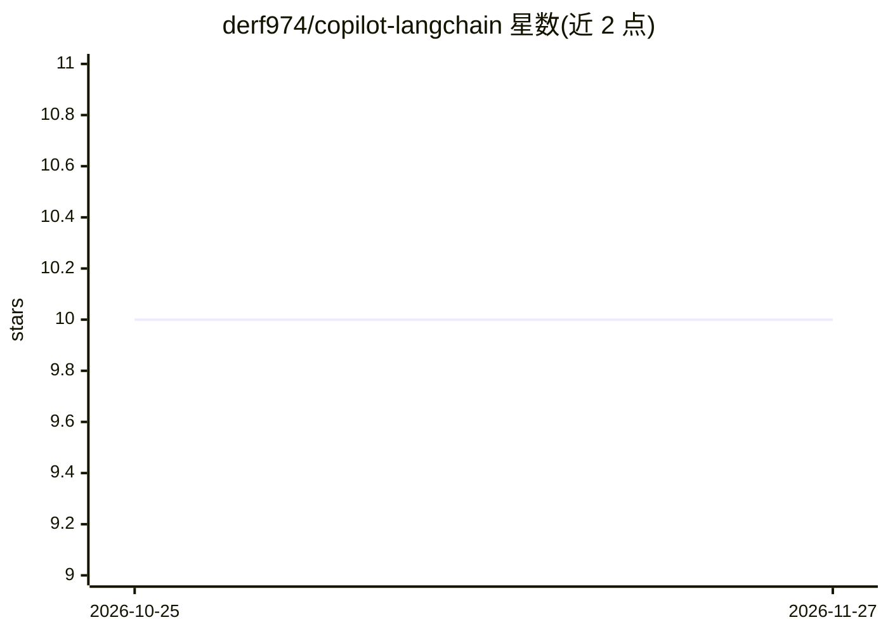

# derf974/copilot-langchain

⭐ 10 · Python · MIT · 推送 2026-10-23 · [GitHub](https://github.com/derf974/copilot-langchain) · 个人维护

**LangChain 接入 GitHub Copilot 模型的集成库**

提供 LangChain 的 CopilotChatModel 聊天模型封装，通过 GitHub Copilot SDK/CLI 在 LangChain 应用中调用 Copilot 模型；支持同步/异步调用、流式输出、Base64 与 data URL 图像输入，共享懒初始化的 CopilotClient。依赖已认证的 GitHub Copilot CLI 与有效订阅，Python 3.13+；工具调用与结构化输出尚未支持。提供 PyPI 包、示例目录与单元/集成测试。

## 筛选速览

| 维度 | 判定 | 备注 |
|---|---|---|
| AI 角色 | `ai-ecosystem` | LLM/agent 周边工具 |
| 许可风险 | `permissive` | MIT |
| 部署形态 | `library` | 以包/库形式分发 |
| 模型依赖 | — | README 未给出锁定关系 |
| 硬件要求 | — | 无带数字的原话,不猜 |
| 安装摩擦 | `low` | 无编译、无系统依赖或容器化 |
| 成熟度 | — | 结构信号不足 |

## 能力要点

- 同步/异步调用与流式输出，兼容 LangChain 流式接口
- Base64 与 data URL 图像输入（暂不支持远程 HTTP 图像 URL）
- 多实例共享懒初始化 CopilotClient
- LangChain 标准单元/集成测试套件验证

## 适用场景

- 在 LangChain chain 中使用 GitHub Copilot 订阅内的模型
- 需要流式或多模态图像输入的对话应用
- 为已有 Copilot CLI 订阅的团队接入 LangChain 工作流

## 场景标签

 · 领域:LLM 基础设施/框架集成

## 证据(README 行号)

> L6: LangChain integration for GitHub Copilot SDK - Use GitHub Copilot models in your LangChain applications.
> L22: 1. **GitHub Copilot CLI** installed and authenticated
> L216: LangChain messages are automatically converted to Copilot SDK format:

## 星数曲线

2026-10-25 10 → 2026-11-27 10（+0）

---
*卡片 v1 · prompt 1.4 · 生成 2026-11-19 · 置信度 high · 依据 README sha `aa407bf49f1b` · [字段定义](../../DATASET.md)*
