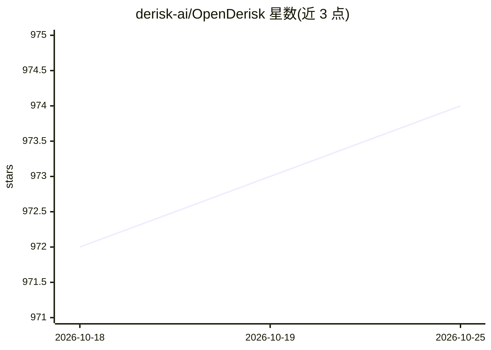

# derisk-ai/OpenDerisk

⭐ 974 · Python · MIT · 推送 2026-09-17 · [GitHub](https://github.com/derisk-ai/OpenDerisk) · 组织维护 · 中文 README

**面向应用系统运维的 AI 风险智能管理与根因分析系统**

AI-Native 风险智能系统，用于 AIOps/SRE 场景的 7×24 小时系统保护。核心机制为多智能体协作（SRE-Agent、Code-Agent、ReportAgent、Vis-Agent、Data-Agent），基于微软 OpenRCA 数据集（解压约 26GB）做根因分析，Code-Agent 动态编写分析代码，并以 Vis 协议可视化诊断过程与证据链。提供 curl 安装脚本与源码（uv）两种安装方式，Web UI 运行于 localhost:7777。限制：数据集需另行下载且体积大，API key 需手动配置。

## 筛选速览

| 维度 | 判定 | 备注 |
|---|---|---|
| AI 角色 | `ai-native` | 本体是模型或模型工具 |
| 许可风险 | `permissive` | MIT |
| 部署形态 | `None` |  |
| 模型依赖 | — | README 未给出锁定关系 |
| 硬件要求 | — | 无带数字的原话,不猜 |
| 安装摩擦 | `low` | 无编译、无系统依赖或容器化 |
| 成熟度 | — | 结构信号不足 |

## 能力要点

- 多智能体协作根因分析（分析日志、trace 与代码）
- 基于微软 OpenRCA 数据集（解压约 26GB）
- 诊断过程与证据链的可视化渲染
- 支持 MCP 工具与 derisk-skills 扩展开发

## 适用场景

- 运维告警的根因定位与深度分析
- 上传火焰图（Java/Python）做性能分析
- 上传指标/日志/trace 数据进行对话式数据分析
- 构建企业内部 AI-SRE 能力并复用其多智能体框架

## 场景标签

`多智能体` `数据分析` · 领域:Agent 开发

## 证据(README 行号)

> L3: OpenDeRisk is an AI-Native Risk Intelligence System designed as your application system's intelligent manager, provi
> L32: 3. **Multi-Agent Collaboration:** SRE-Agent, Code-Agent, ReportAgent, Vis-Agent, and Data-Agent working in coordina
> L43: **Logic Layer:** Multi-agent architecture with SRE-Agent, Code-Agent, ReportAgent, Vis-Agent, and Data-Agent collab

## 星数曲线

2026-10-18 972 → 2026-10-25 974（+2）

---
*卡片 v1 · prompt 1.4 · 生成 2026-10-21 · 置信度 high · 依据 README sha `c6e89ad9c358` · [字段定义](../../DATASET.md)*
